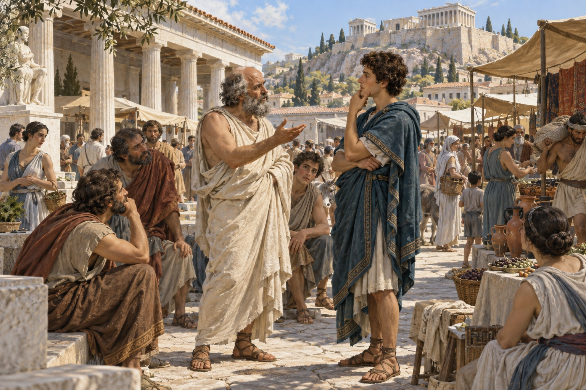
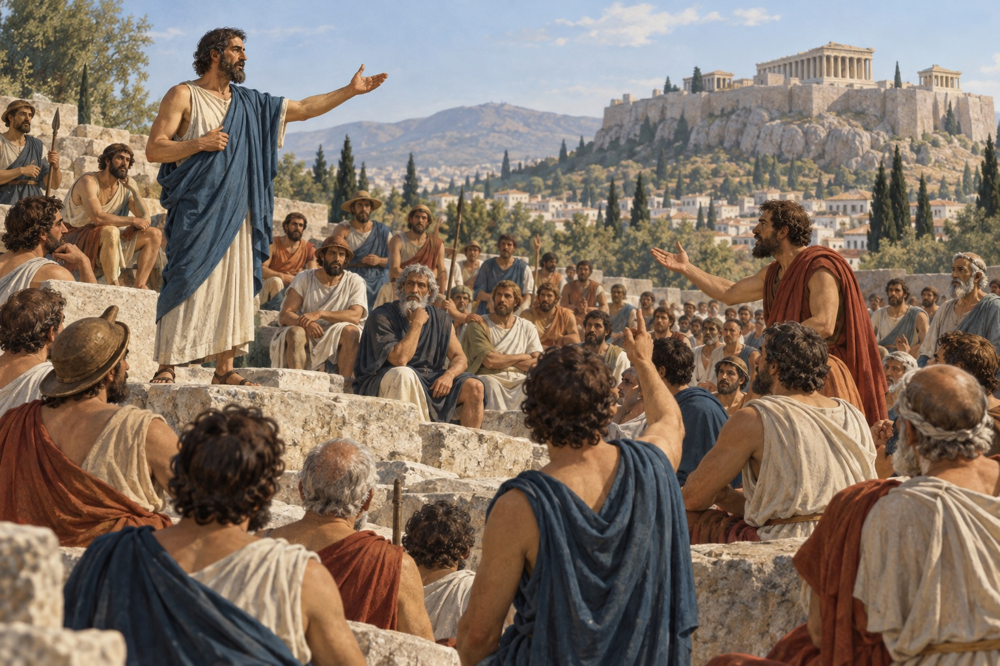

# Greek Ethics, Part 1 — Who Gets to Decide What Is Right?

**Ethics and Leadership · Due Friday, October 16, 2026 · Reading time: approximately 10–15 minutes**

## 1. A father enters the enemy's tent

An old man approaches the warrior who killed his son. He takes the warrior's hands and asks him to remember his own father. In Homer's **Iliad**, the visitor is Priam, king of Troy; the warrior is Achilles. Achilles has killed Hector and refused to return his body. Now both men cry. Achilles agrees to give the body back. This is an episode from an ancient poem, not a verified report of an actual meeting. Yet it presents a serious problem: can loyalty to your own people leave room for an enemy's grief? [Homer, *Iliad*, Book 24](https://classics.mit.edu/Homer/iliad.24.xxiv.html).

Greek thinking about right and wrong did not begin with philosophers delivering lectures. Poems, religious practices, families, and laws already taught people what deserved admiration or shame. **Morality** can mean these lived standards of conduct. **Ethics** is the careful examination of how we should live and why those standards deserve acceptance. The terms overlap; this distinction helps us notice the difference between inheriting a rule and giving reasons for it.

## 2. Excellence for whom?

In heroic stories, **aretē** means excellence: being outstanding at something that matters. A warrior might win honor through courage, strength, and loyalty. But being excellent at fighting does not settle whether a war is just. Achilles' encounter with Priam exposes a tension within the heroic world itself. The poem offers more than an instruction to win. It lets its audience witness someone recognizing suffering across an enemy line.

Later philosophers would ask what excellence means for an entire human life. That question was not invented in isolation. Greek-speaking communities traded, migrated, fought, and learned around the Mediterranean. Nor was ancient Greece one country with one moral code. It contained many **poleis**, or city-states, with different institutions. Ideas about a good person were closely connected to ideas about a good citizen. That connection also raised a harder question: what if your city admired the wrong things?

*AI-generated imagined reconstruction of an Athenian marketplace conversation. It is not evidence of a particular meeting.*

## 3. A city that argues

In fifth-century BCE Athens, adult male citizens could debate and vote in the assembly. This **democracy** gave citizens direct responsibilities that many modern voters give to representatives. But political membership was restricted: women, enslaved people, and resident foreigners could not participate as citizens in the assembly. Athens also exercised power over other communities. Its freedom was real for some people and sharply limited for others. [Background: *Ancient Political Philosophy*](https://plato.stanford.edu/entries/ancient-political/).

These institutions made speaking well valuable. The **Sophists**, a diverse group of teachers rather than one united school, offered education including **rhetoric**, the art of persuasion. They helped make questions about law, education, and human conduct central to philosophy. A persuasive speech could defend someone unfairly accused. It could also make a weak argument sound convincing. Should education teach students to win, or to deserve to win?

Sophists examined the relationship between **nomos**, law or convention, and **physis**, nature. If societies disagree about what is proper, perhaps some supposedly natural rules are human arrangements. That possibility could challenge unfair customs. However, it did not automatically show that every custom was equally good. Different Sophists drew different conclusions. Treating them all as dishonest tricksters repeats the judgment of their opponents instead of examining their arguments. [Background: *The Sophists*](https://plato.stanford.edu/entries/sophists/).

Earlier thinkers, often called **Presocratics**, had already sought explanations of the world through arguments about nature, change, and order. They were not one school, and some lived alongside Socrates. Their significance here is a habit of inquiry: an inherited story need not end a question. Religious explanations and reasoned investigation also coexisted; Greek history was not a simple switch from superstition to reason. [Background: *Presocratic Philosophy*](https://plato.stanford.edu/entries/presocratics/).

## 4. The man who would not stop asking

**Socrates** made examining one's life an urgent task. He wrote no surviving philosophical works. We meet him mainly through other authors, especially Plato and Xenophon, whose portraits differ. In Plato's *Apology*, Socrates tells an amusing story: an oracle declared that nobody was wiser than he was. Puzzled, he questioned people famous for wisdom. He found that expertise in one area often came with unjustified confidence about everything else. His advantage, he suggests, was recognizing the limits of his knowledge.

The **Socratic method** tests a claim through questions, examples, and contradictions. Consider this invented classroom example: someone defines courage as never retreating. Another student asks about a firefighter who withdraws from an unsafe building to organize a rescue. Retreat now looks compatible with courage. The first definition needs repair. Being questioned can feel embarrassing, but embarrassment is not itself proof that an argument is wrong.

Socrates' questioning also had political stakes. In the *Apology*, he reports refusing an order from Athens' oligarchic rulers to help arrest Leon of Salamis. **Oligarchy** means rule by a few. Socrates presents this refusal as evidence that avoiding wrongdoing mattered more to him than personal safety. His claim asks us to distinguish **authority**, the power or recognized right to command, from **justification**, a good reason to obey. Plato's account is a defense of Socrates, not a neutral transcript. [Plato, *Apology*, especially 20–23 and 32](https://classics.mit.edu/Plato/apology.html).

*AI-generated imagined reconstruction of the assembly. Its male citizen audience reflects a political exclusion, not the whole population of Athens.*

## 5. When obedience and justice separate

In another Platonic dialogue, *Euthyphro*, Socrates meets a man confident that he understands religious duty. Their discussion asks whether the gods love what is holy because it is holy, or whether their love makes it holy. This is a question about the source of a standard. A modern comparison would be asking whether a rule is fair because a leader approves it, or whether the leader should approve it because it is fair. The comparison is ours; it is not Plato's wording. [Plato, *Euthyphro*, 10–11](https://classics.mit.edu/Plato/euthyfro.html).

In 399 BCE, an Athenian jury convicted Socrates on charges involving impiety and corrupting the young, and he was executed. His trial followed war, defeat, oligarchic violence, and the restoration of democracy. This context helps explain anxieties about civic loyalty; it does not establish that his punishment was just. [Background: *Socrates*](https://plato.stanford.edu/entries/socrates/).

Here is the unresolved problem: a community needs enough shared trust to act, but it also needs people who challenge its mistakes. **When does questioning authority serve a community, and what responsibilities does the questioner have toward it?** Consider both the quality of the challenge and the power of those who want it silenced.

## Discuss: Ideas Under Examination

Post one question anchored in a passage or specific detail. Your question may ask what a concept means, how to interpret an argument, or whether a judgment is justified. Then develop one reply or Principles Portfolio entry of approximately **100–180 words total** using the prompts below. These are not three separate essays. You may choose an idea from the class question list and credit its contributor.

1. **What idea here deserves examination?** Identify a claim, rule, judgment, or assumption. Anchor it in a short quotation or specific detail, and explain it in your own words.
2. **What is the strongest reason to accept it—and what makes it difficult to accept?** Use the text and discussion. Distinguish reasons the text gives from reasons you are proposing.
3. **Where do you stand for now, and why?** Defend, qualify, reject, or leave the idea unresolved. Explain what your judgment depends on.

Optional starters: “The passage suggests…”, “A reason to accept this is…”, “This becomes difficult when…”, “For now, I think… because…”.

**After discussion:** Return to your judgment. Keep it, clarify it, or change it, and explain what in the reading or discussion supports your decision. If you remain unsure, name the difficulty.

**Optional extension:** Identify an unstated assumption in one argument and explain how its conclusion depends on that assumption.

## Sources and evidence

This reading paraphrases the sources linked beside the relevant passages. Ancient dialogues and stories are evidence of arguments and representations; they are not automatically reliable transcripts of events.

- [Homer, *Iliad*, Book 24](https://classics.mit.edu/Homer/iliad.24.xxiv.html)
- [Background: *Ancient Political Philosophy*](https://plato.stanford.edu/entries/ancient-political/)
- [Background: *The Sophists*](https://plato.stanford.edu/entries/sophists/)
- [Background: *Presocratic Philosophy*](https://plato.stanford.edu/entries/presocratics/)
- [Plato, *Apology*, especially 20–23 and 32](https://classics.mit.edu/Plato/apology.html)
- [Plato, *Euthyphro*, 10–11](https://classics.mit.edu/Plato/euthyfro.html)
- [Background: *Socrates*](https://plato.stanford.edu/entries/socrates/)

Internet Classics Archive translations used: Homer: Samuel Butler. Plato: Benjamin Jowett.
