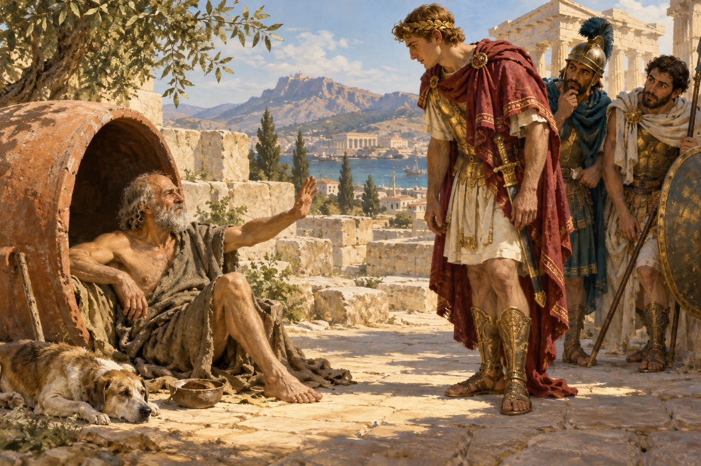
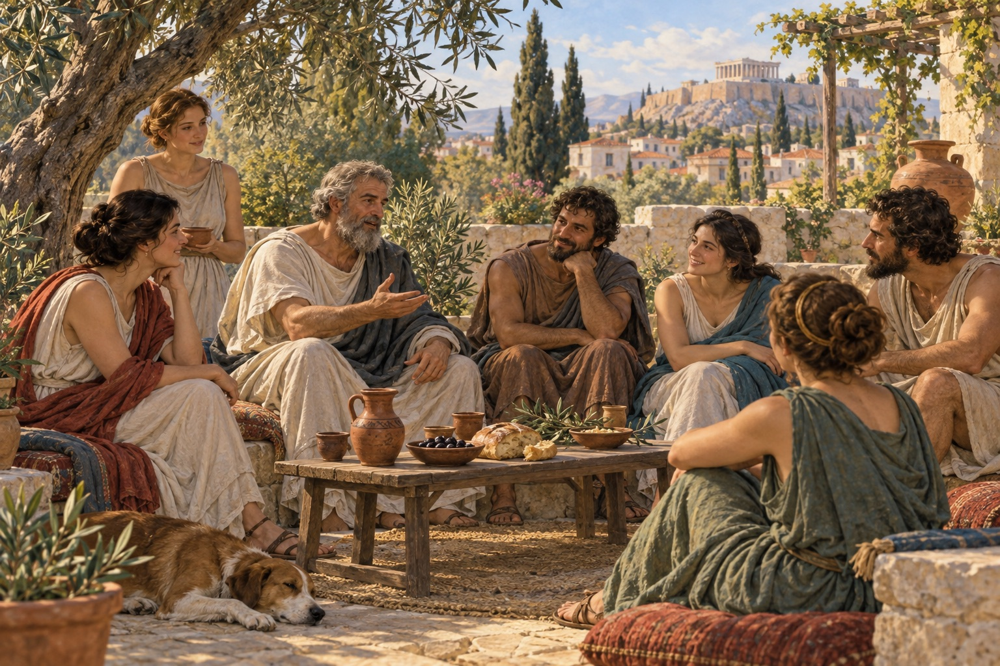

# Greek Ethics, Part 3 — How Can We Live Well When Power Is Elsewhere?

**Ethics and Leadership · Due Friday, October 23, 2026 · Reading time: approximately 10–15 minutes**

## 1. The king and the patch of sunlight

According to a famous ancient anecdote, Alexander the Great approached **Diogenes** and offered to grant him a wish. Diogenes wanted the powerful visitor to stop blocking his sunlight. The joke reverses their positions: the king possesses enormous resources, yet has nothing the philosopher needs at that moment. The surviving reports are later accounts, not eyewitness transcripts. We cannot confidently verify the encounter. Its importance is what the story asks: how much power does another person have over you if you no longer want their rewards? [Background: *Diogenes of Sinope*](https://iep.utm.edu/diogenes-of-sinope/).

*AI-generated illustration of a traditional anecdote whose historical accuracy is uncertain.*

Alexander's conquests and his death in 323 BCE helped create the world historians call **Hellenistic**. Large kingdoms linked Greek-speaking communities with Egypt, western Asia, and lands farther east. Cities continued to govern many local affairs, but kings and armies shaped the possibilities around them. Philosophical schools offered accounts of how to live under these conditions. They were not all simply fleeing politics: they disagreed over what independence and responsibility required. [Historical context: Metropolitan Museum](https://www.metmuseum.org/essays/art-of-the-hellenistic-age-and-the-hellenistic-tradition).

## 2. Cynics: reduce what can buy you

The **Cynics** treated philosophy as a way of living visibly against convention. They were a loose movement, not a school with one official classroom. Their **self-sufficiency** meant training themselves to need less and to resist dependence on status or luxury. Ancient stories describe Diogenes living in a large storage jar. The modern phrase “living in a barrel” can give us the wrong picture: think of an enormous ceramic container.

Cynic **frank speech** challenged the powerful without flattering them. Their influence on ethics was to make a person's actual way of life a test of their claimed values. If someone praises freedom but cannot bear losing fashionable possessions, how free are they? Cynic practice helped shape early Stoicism. Yet a difficulty remains: reducing your own needs does not automatically change institutions that deny other people necessities. Freely chosen simplicity and involuntary poverty are different conditions. [Background: *Cynics*](https://iep.utm.edu/cynics/).

## 3. Epicureans: what is enough?

**Epicurus** founded a philosophical community known as the **Garden**. His goal was **pleasure**, but not an endless banquet. He distinguished desires that meet natural necessities from desires that produce an exhausting chase after wealth, prestige, or limitless enjoyment. A simple meal can satisfy hunger. No final amount of admiration guarantees that nobody will ever ignore you again.

In his *Letter to Menoeceus*, Epicurus explains that choosing well sometimes means refusing an immediate pleasure because it brings greater pain, or accepting a difficulty because it brings a better life. **Tranquility**, freedom from mental disturbance, matters alongside freedom from bodily pain. This makes Epicureanism a discipline of judgment rather than permission to indulge every impulse. Its ethical challenge is to ask whether the things we pursue actually make life better. [Epicurus, *Letter to Menoeceus*](https://classics.mit.edu/Epicurus/menoec.html).

*AI-generated imagined reconstruction of an Epicurean gathering; the individuals and occasion are invented.*

**Friendship** was central to security and enjoyment, and the Garden included women and enslaved people. Epicurus generally counseled avoiding political ambition, which could create fear and dependence. This did not mean that other people were irrelevant. A small community of friends offered a different form of shared life. [Background: *Epicurus*](https://plato.stanford.edu/entries/epicurus/).

His *Principal Doctrines* describes **justice** through agreements that prevent people from harming one another. Laws matter because of the mutual benefit they provide, rather than merely because they are old. That approach invites us to examine whether an arrangement still protects those living under it. But it also raises a question: how should people respond when powerful groups offer agreements on terms that others have little freedom to refuse? [Epicurus, *Principal Doctrines*, 31–38](https://classics.mit.edu/Epicurus/princdoc.html).

## 4. Stoics: character, circumstance, and duty

**Stoicism**, founded by Zeno of Citium, took its name from the painted porch, or **stoa**, associated with his teaching. Stoics argued that **virtue** is the only unconditional good. Health, money, and reputation may be reasonably preferred, but possessing them does not make someone good. Their absence does not make someone morally worthless. A ruler can control your position more easily than your capacity to judge what deserves respect.

Stoic ethics nevertheless included duties toward others. The idea of **cosmopolitanism**, membership in a wider human community, challenged the assumption that moral concern should stop at a city's border. Sharing rational capacities could matter more than political membership. This was not a modern system of equal legal rights, and Stoics did not all take identical political positions. Their influence was partly a larger horizon of obligation, alongside an emphasis on disciplined character. [Background: *Stoicism*](https://plato.stanford.edu/entries/stoicism/).

The later Greek-speaking Stoic **Epictetus**, who lived under Roman rule, opens his *Handbook* by distinguishing what depends on us from what does not. Our judgments and choices differ from possessions, reputation, or office, which depend on other people and circumstances. This is not a promise of total control over feelings, nor an instruction to abandon efforts that might fail. You can choose to make a careful argument without controlling whether a governor accepts it. [Epictetus, *Enchiridion*, section 1](https://classics.mit.edu/Epictetus/epicench.html).

## 5. Skeptics: can you live without certainty?

Ancient **Skeptics** challenged confident claims to knowledge. Different traditions developed, including Academic skepticism and **Pyrrhonian skepticism**. Pyrrhonists sought **suspension of judgment** when opposing arguments seemed equally persuasive. They associated this with tranquility, while continuing ordinary life according to appearances, practices, and experience. They did not need to prove that every statement was false; that would itself be a confident claim.

This approach gives ethics a valuable challenge: separate what seems right to you from what you have established. But suspension has costs if a decision cannot wait. Uncertainty about the best policy does not remove the need to decide who receives food during a shortage. Skepticism tests confidence; it does not magically settle responsibility. [Background: *Ancient Skepticism*](https://plato.stanford.edu/entries/skepticism-ancient/).

## 6. Four responses to a difficult world

Consider this invented case. A city leader announces an unfair food-distribution rule. A resident can challenge it publicly, support affected neighbors privately, or investigate before acting. The schools above suggest different questions about dependence, suffering, duty, and certainty; none is a mechanical answer machine. Change one circumstance: the resident now holds an office with direct responsibility for distributing food. Does advice suitable for a private person still fit?

Across these readings, Greek philosophy has made ethics a dispute about reasons, character, pleasure, justice, and shared life. Its influence lies in questions as well as answers. **When is protecting your own peace a reasonable limit, and when does responsibility require disturbing it?** Decide what the answer depends on, rather than assuming that either public action or private tranquility is always the more ethical choice.

## Discuss: Ideas Under Examination

Post one question anchored in a passage or specific detail. Your question may ask what a concept means, how to interpret an argument, or whether a judgment is justified. Then develop one reply or Principles Portfolio entry of approximately **100–180 words total** using the prompts below. These are not three separate essays. You may choose an idea from the class question list and credit its contributor.

1. **What idea here deserves examination?** Identify a claim, rule, judgment, or assumption. Anchor it in a short quotation or specific detail, and explain it in your own words.
2. **What is the strongest reason to accept it—and what makes it difficult to accept?** Use the text and discussion. Distinguish reasons the text gives from reasons you are proposing.
3. **Where do you stand for now, and why?** Defend, qualify, reject, or leave the idea unresolved. Explain what your judgment depends on.

Optional starters: “The passage suggests…”, “A reason to accept this is…”, “This becomes difficult when…”, “For now, I think… because…”.

**After discussion:** Return to your judgment. Keep it, clarify it, or change it, and explain what in the reading or discussion supports your decision. If you remain unsure, name the difficulty.

**Optional extension:** Identify an unstated assumption in one argument and explain how its conclusion depends on that assumption.

## Sources and evidence

This reading paraphrases the sources linked beside the relevant passages. Ancient dialogues and stories are evidence of arguments and representations; they are not automatically reliable transcripts of events.

- [Background: *Diogenes of Sinope*](https://iep.utm.edu/diogenes-of-sinope/)
- [Historical context: Metropolitan Museum](https://www.metmuseum.org/essays/art-of-the-hellenistic-age-and-the-hellenistic-tradition)
- [Background: *Cynics*](https://iep.utm.edu/cynics/)
- [Epicurus, *Letter to Menoeceus*](https://classics.mit.edu/Epicurus/menoec.html)
- [Background: *Epicurus*](https://plato.stanford.edu/entries/epicurus/)
- [Epicurus, *Principal Doctrines*, 31–38](https://classics.mit.edu/Epicurus/princdoc.html)
- [Background: *Stoicism*](https://plato.stanford.edu/entries/stoicism/)
- [Epictetus, *Enchiridion*, section 1](https://classics.mit.edu/Epictetus/epicench.html)
- [Background: *Ancient Skepticism*](https://plato.stanford.edu/entries/skepticism-ancient/)

Internet Classics Archive translations used: Epicurus: Robert Drew Hicks. Epictetus: Elizabeth Carter.
