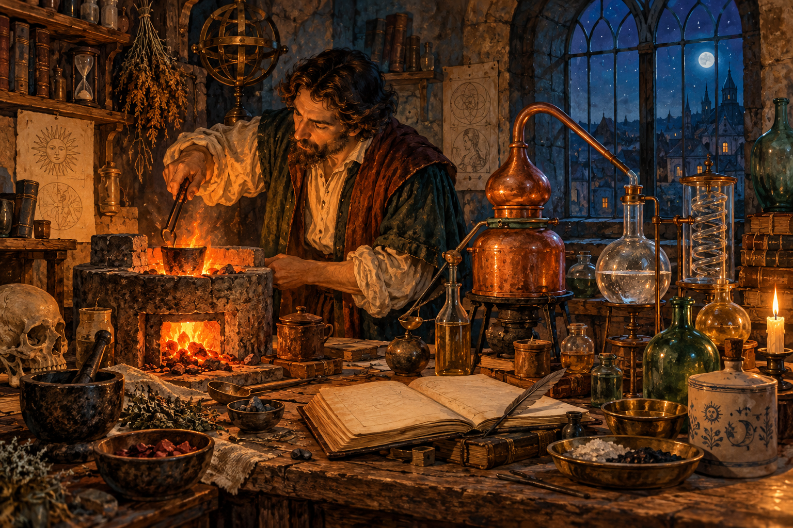
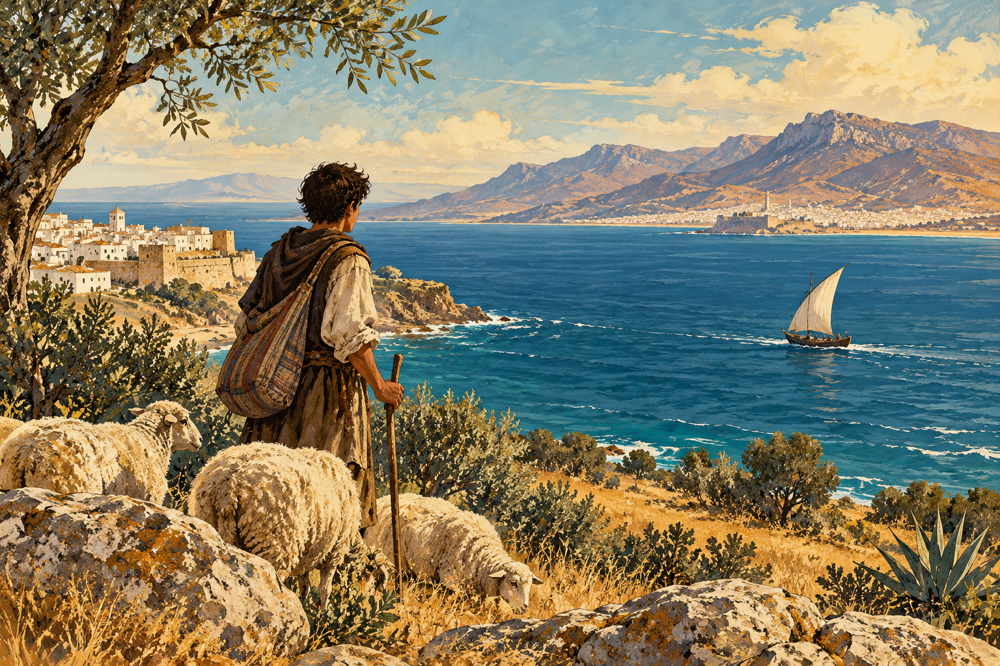
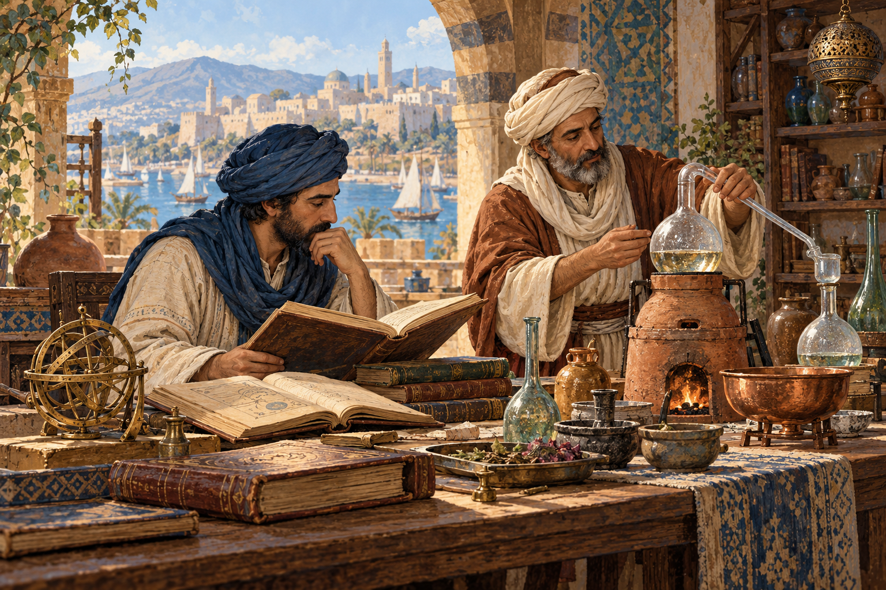
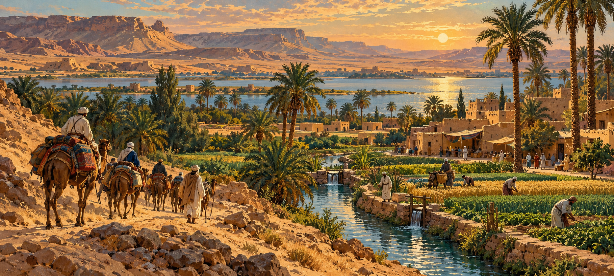

# The World Behind The Alchemist: Gold, God, and the Desert

## A furnace that refuses to answer

A man has spent hours beside a furnace. He has weighed ingredients, heated them, watched their colors change, and written down what happened. Somewhere inside this troublesome material, he believes, nature has hidden a secret. Discover it, and an ordinary metal might become gold.

That could describe an alchemist in a story. It also describes work pursued by Isaac Newton, the thinker famous for gravity. In seventeenth-century England, Newton studied alchemical manuscripts and carried out experiments. His notebooks survive. The person helping to explain the movements of planets was also trying to understand matter through a tradition we now associate with mysterious powders and impossible promises. [Newton's surviving papers](https://newton.dlib.indiana.edu/) make that combination visible.

Newton wasn't secretly taking a holiday from thinking. He was investigating a world whose boundaries of knowledge differed from ours. The history behind Paulo Coelho's *The Alchemist* begins there: with people who suspected that apparently ordinary things concealed extraordinary possibilities.

*AI-generated interpretation of an alchemical workshop; not a portrait of Newton or historical evidence.*

## Why gold seemed possible

Alchemy brought together experiments with substances, theories about nature, and sometimes religious or spiritual ambitions. It was never one agreed system. Different practitioners wanted different things: better medicines, valuable pigments, longer life, or the transformation of inexpensive metals into precious ones.

The word for that last ambition is **transmutation**: changing one substance into another. Some alchemists imagined metals as different degrees of perfection within a shared natural process. Gold represented an especially perfect condition. If nature could produce it underground, perhaps a skilled person could help the process along. The **philosopher's stone** was the hoped-for substance that could make such transformations possible; traditions also associated remarkable healing powers with it. This wasn't necessarily a jewel-shaped rock. Accounts varied. [The Royal Society of Chemistry](https://periodic-table.rsc.org/alchemy/what-is-alchemy) outlines these ambitions.

Everyday experience made radical change seem less absurd than it sounds. Fire turns wood into ash. Heat draws metal from ore. A liquid disappears and leaves crystals behind. Matter seems full of surprises. Without our knowledge of atoms, the line between a difficult transformation and an impossible one was hard to draw.

Ordinary chemical reactions cannot turn lead into gold. But unsuccessful hopes could sit beside useful knowledge. Alchemists and artisans worked with furnaces, minerals, medicines, glass, and dyes. Their practical skills overlapped. The [Metropolitan Museum's account of alchemy and making](https://www.metmuseum.org/perspectives/alchemy-science-making-marvels) shows that experimental work, craft, and speculation often occupied the same room.

Coelho uses that crowded room as a literary opportunity. Gold can be valuable metal and a **symbol**, something concrete that carries a larger meaning. An imperfect substance becoming something precious offers a way to imagine a life changing. Santiago’s **Personal Legend**, the calling he is meant to pursue, makes his own development part of the search. The **Soul of the World** gives that search a cosmic setting: Coelho imagines lives and natural things participating in a shared spiritual reality. Through this lens, learning about metal and learning about oneself can belong to the same adventure. This is the novel’s imaginative use of alchemy, not a claim that every historical alchemist was secretly writing self-help.

## A narrow sea, a much larger crossing

Santiago begins in Andalusia, southern Spain, with sheep, familiar routines, and a desire to travel. He heads toward Tarifa and crosses to Tangier in Morocco. The sea crossing is much smaller than the journey toward Egypt. Yet arriving where his Spanish no longer helps him produces an enormous change: knowledge that made him capable at home suddenly isn't enough.

*AI-generated imagined view across the Strait of Gibraltar, evoking Santiago's departure.*

The shores are close, and their histories are entangled. From 711 onward, Muslim rulers controlled changing areas of the Iberian Peninsula, known in Arabic as **al-Andalus**. This wasn't exactly the same territory as modern Andalusia. Across centuries, Muslim, Christian, and Jewish communities lived under changing governments, sometimes exchanging knowledge and sometimes facing coercion, conflict, or expulsion. The beautiful buildings left behind belong to that complicated history. [The Met's account of Islamic Spain](https://www.metmuseum.org/essays/the-art-of-the-umayyad-period-in-spain-711-1031) introduces its early centuries.

Santiago's departure therefore crosses a religious and linguistic boundary between places already connected by history. The journey feels unfamiliar to him; that doesn't make North Africa an unfamiliar place to itself. Tangier has merchants, customers, obligations, and people trying to earn a living before a Spanish shepherd arrives.

This matters because Coelho's setting can feel timeless. The book is a modern work, first published in Portuguese in Brazil in 1988, as its [early manuscript record](https://fondationpaulocoelho.com/archive/pc-bk-1988-alc-early-manuscript-the-alchemist-01/) confirms. Its old-fashioned atmosphere doesn't provide a precise historical date. Reading it as a map of one actual medieval year would create problems the novel never tries to solve.

## Knowledge travels too

Alchemy made journeys of its own. Greek-language traditions developed in the ancient Mediterranean, including Egypt. Scholars writing in Arabic studied, changed, and expanded inherited material. Later, Arabic works entered Latin-reading Europe through translation. These were acts of interpretation and investigation, not simply delivery of sealed packages.

The English word *alchemy* comes through Arabic *al-kimiya*. Arabic-speaking investigators examined substances and processes such as **distillation**: heating a liquid, collecting its vapor, and cooling it back into liquid. Such techniques mattered for perfumes, medicines, and other practical products. The [National Library of Medicine's manuscript catalogue](https://www.nlm.nih.gov/hmd/arabic/alchemy1.html) explains how closely chemical technology and alchemical inquiry could overlap.

*AI-generated interpretation of a Mediterranean scholarly workshop; no particular manuscript or individual is depicted.*

Even famous names could be slippery. Alchemical works were sometimes attributed to ancient authorities who hadn't written them. Hermes Trismegistus, associated with the Emerald Tablet, was a legendary sage, rather than a securely documented author. Oxford's [introduction to Islamic alchemy](https://www.cabinet.ox.ac.uk/islamic-alchemy-primer) describes this practice of attaching texts to prestigious names.

The **Emerald Tablet** is a short text associated with connections between the world above and the world below. Its authority came wrapped in legend. In the novel, it belongs to a larger possibility: that a small thing might contain a pattern found throughout the universe. The [Hallie Ford Museum's introduction](https://library.willamette.edu/hfma/omeka/exhibits/show/salvador-dali--alchimie-des-ph/the-emerald-tablet) places it within the alchemical tradition.

Coelho gives this history a human shape through the Englishman, who travels with books, and Santiago, who learns by attending to people and surroundings. Their different habits sharpen a tension inside the story. A written account can preserve what someone discovered. Possessing it doesn't guarantee the ability to recognize what is happening beside a camel.

## Old names entering a new story

Other travelers enter the novel from older books. Melchizedek, the mysterious king Santiago meets, comes from the Bible. In Genesis 14, Melchizedek is king of Salem and a priest who blesses Abram. Coelho takes that brief, unusual figure and gives him a new encounter. This is an **allusion**: a reference that brings an earlier story into the present one. The earlier text adds depth without supplying a complete explanation. [Genesis 14:18–20](https://www.biblegateway.com/passage/?search=Genesis%2014%3A18-20&version=NET) provides the original encounter.

Urim and Thummim have a biblical background too. Exodus associates them with a priest seeking divine judgment. Their exact ancient form and use are uncertain. Coelho turns the names into two stones Santiago can consult. The novel's clear little system is a creative adaptation, rather than an archaeological reconstruction. [Exodus 28:30](https://www.biblegateway.com/verse/en/Exodus%2028%3A30) gives their earlier setting.

The crystal merchant's longing for Mecca belongs to a living religious practice. **Hajj**, pilgrimage to Mecca, is a duty for Muslims who are physically and financially able to undertake it. A pilgrimage is travel with a sacred purpose. For the merchant, the journey also becomes something he has imagined for so long that imagining it helps sustain his ordinary days. The [Ashmolean Museum's account of pilgrimage](https://jameelcentre.ashmolean.org/collection/6/10234/10328) explains the religious setting behind that desire.

These traditions aren't interchangeable. A Christian shepherd, a biblical priest-king, and a Muslim merchant carry different inheritances. Coelho brings them into conversation through his own spiritual vision. His suggestion of a shared language underneath religious differences is part of the novel's outlook; it doesn't establish that every religion teaches the same thing.

## A desert full of work

As the journey continues, the desert seems to strip life down. Water matters. Direction matters. Other travelers' knowledge matters. A caravan joins people together because crossing difficult country requires coordination and supplies. The landscape that appears to offer freedom also produces dependence.

*AI-generated interpretation of cultivated land at Fayoum's desert edge; not a reconstruction of the novel's oasis.*

Al-Fayoum, the oasis in the novel, refers to a real Egyptian region. Its fields and settlements depend on water managed through canals connected to the Nile system. UNESCO's [description of Fayoum's cultural landscape](https://whc.unesco.org/en/tentativelists/1830/) records a place shaped by agriculture and hydraulic works. An oasis is more than a lucky patch of shade. People keep it alive through labor and organization.

The pyramids likewise belong to a particular history: ancient Egyptian royal tombs, built long before the religious worlds Santiago encounters. In Coelho's story, they become a distant destination onto which a traveler can project desire. Their real weight and scale help give physical form to an imagined future.

Across this landscape, **omens**—events interpreted as signs—offer Santiago another way of finding direction. A shepherd already watches animals, weather, and ground. Coelho extends that habit into a universe where observation may become communication. The marvelous enters a world of wages, fatigue, hunger, and bargaining with surprisingly little ceremony. The novel's matter-of-fact tone helps the ordinary and the impossible share the road.

Back beside the furnace, the alchemist still has practical problems. The vessel can crack. The heat can be wrong. A promising color can disappear. A book may describe success while the experiment produces a stubborn lump. Santiago's journey draws on that same mixture of attention, longing, inherited stories, and uncertain results. Before anyone can discover what the material might become, someone has to stay beside it and watch.
