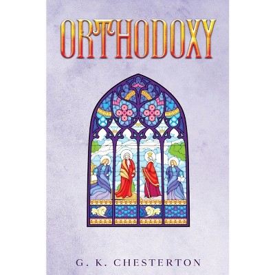
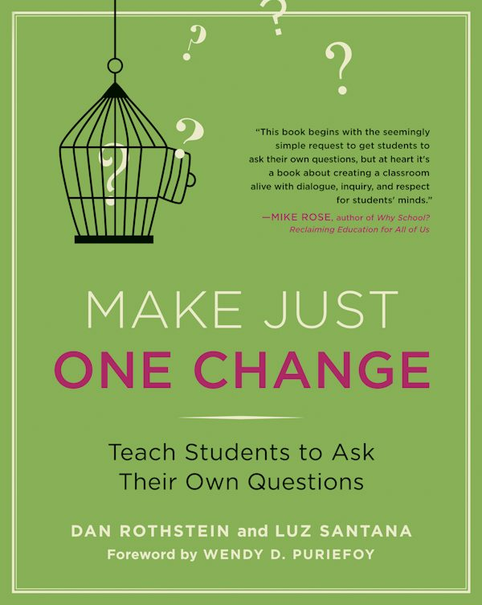
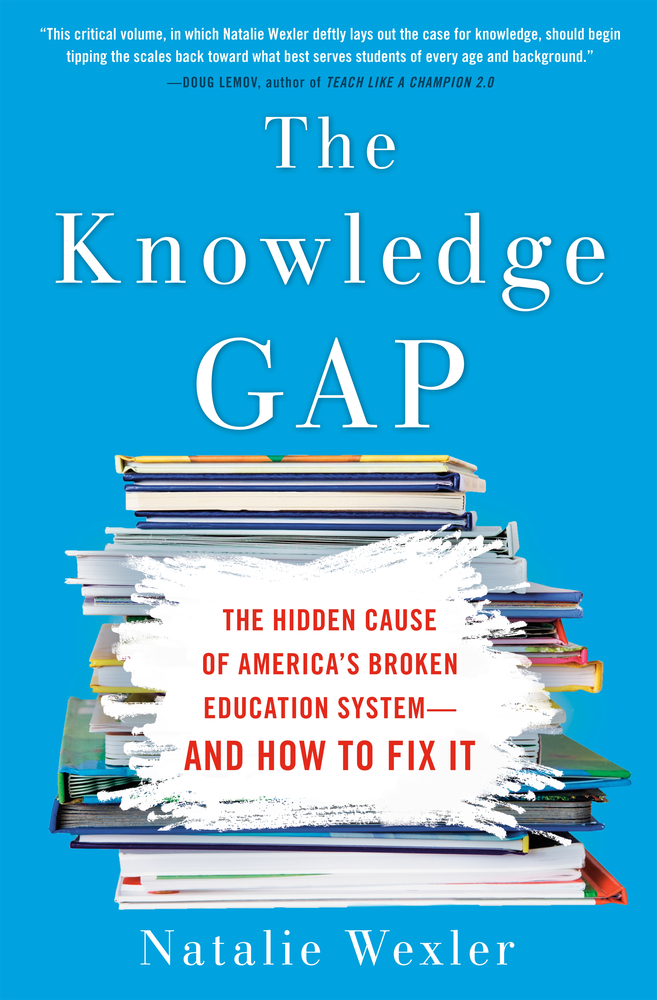

# Do It Again

*On exhausted teachers, suspiciously quiet classrooms, and the possibility that learning was interesting all along.*

**David Hepting · Lifeplus Workshop · November 2026**

## I. The best-educated person in the room

I had big dreams as a new teacher.

Every class would be fun, engaging, and different. Students would arrive expecting challenging ideas, surprising connections, and activities that made them forget to check the clock. I would make learning come alive.

Then I started teaching, and began to suspect that learning and I could not both remain alive on this schedule.

My first year was in Stanley Mission, an Indigenous community in northern Saskatchewan. Attendance was patchy. Many students struggled with the academic work, but what troubled me most was their conviction that they could never become good at it. I was brand new. Families who wondered whether I knew what I was doing had identified a legitimate research question.

Much of my repertoire involved interesting texts, web tools, and inventive activities. Students did not have devices. The Wi-Fi was patchy. The printer often did not work. It is difficult to deliver the classroom of the future when the classroom of the present cannot produce a worksheet.

I remember putting considerable effort into a mathematics lesson involving pebbles. We went outside to find stones and use them for calculations. I imagined discovery, movement, and mathematics becoming tangible. Many students became distracted and talked instead. I had brought the class outside. I had not necessarily brought them any closer to understanding the mathematics.

The pebbles were a small instance of a larger problem. Over those first years, I kept trying to make each lesson new. When I devoted the time needed to make one class exceptional, the other four or five classes received what remained of me. Tomorrow, some other class would get its turn at exceptional. I was operating a rotating shortage of educational brilliance.

Even a promising activity could consume half its energy in explanation. Here are today’s instructions. Here is how the groups work. Here is what you do with the cards. No, the other cards. Students were repeatedly learning how to participate in my latest invention. The ideas I wanted them to learn had to wait for the instructions to finish.

I worked hard. They learned much less than I hoped. I became overwhelmed, discouraged, and increasingly burnt out.

Eventually, a principle began to change the question I was asking:

> **The one who does the work gets the learning.**

I had been finding the interesting material, making connections, anticipating objections, organizing explanations, and inventing questions. Naturally, I was learning a tremendous amount.

The students had the considerable disadvantage of being taught by me.

They were often receiving the finished product of thinking I had already done. My preparation could be intellectually rich while their experience of the lesson remained surprisingly thin. I had confused the amount of work a lesson required of *me* with the amount of thinking it required of *them*.

The principle was not a recommendation to abandon explanation or leave students stranded. It was a question about where the intellectual work was happening. **Who was recalling, choosing, connecting, questioning, and trying to put an idea into words?**

Once I started asking that, other things began to fall into place.

During my teacher training, a Grade 5 teacher had told me that routines were what stood between her and chaos. She had a routine for everything so students knew what to do. I had privately filed this under *excellent advice for people teaching younger children*. My high school classes would be so engaging that we would rise above such administrative concerns.

It turns out adolescence does not abolish the need to know what is happening.

Routines gradually gave my students a familiar way into the work. They also gave me a way out of continually manufacturing a new event. Students became more settled; I spent less time explaining procedures and managing confusion. There was more room for learning, and less preparation required simply to get us to the point where learning could begin.

Mike Schmoker’s *Focus* helped give this change a direction: worthwhile curriculum, sound instruction, and serious attention to reading and writing.\[7\] The rhythm I came to value was simple:

*[*Focus*, third edition — Mike Schmoker. Cover: ASCD.](https://www.ascd.org/books/focus-3rd-edition?variant=126031)*

**Read. Think. Discuss. Write.**

The text could change. The difficulty could increase. The ideas could become stranger and more demanding. We did not have to invent a new educational vehicle every morning before travelling anywhere.

There was still the matter of boredom.

My master’s work had centred on an idea from Chesterton’s *Orthodoxy*: a child asks for a delightful thing to happen again, while the adult tires of supplying it. Chesterton wonders whether this says more about the adult’s depleted vitality than the child’s limited imagination. Perhaps God can “exult in monotony.” Perhaps the daily return of the sun expresses delight rather than mechanical exhaustion. Perhaps “our Father is younger than we.”\[1\]

*[*Orthodoxy* — G. K. Chesterton. Dover edition cover.](https://www.target.com/p/-/A-77730286)*

I find this one of the most profound ideas I have encountered. **Repetition need not mean that the possibilities have been exhausted. It may mean we have found something worth returning to.**

A familiar routine could be the structure that lets students notice something unfamiliar. The question was becoming less “What new thing will I do tomorrow?” and more “What worthwhile thinking will they do—and what will help them do it better?”

## II. Please stop answering for a moment

By the time I encountered the Question Formulation Technique, I was ready for it.

Here was a routine that moved one of the most interesting parts of teaching into students’ hands. They would make the questions.

I immediately knew it was golden.

Teachers are practiced question-makers. We can build an entire discussion around a sequence of prompts designed to lead students toward a discovery we have already made. This can be excellent teaching. It can also become a guided tour in which the guide asks everyone to guess the next exhibit.

Dan Rothstein and Luz Santana’s QFT offers another arrangement. Give students a stimulus: a statement, image, object, or passage. Ask them to generate questions. During this stage, they must not stop to answer, judge, or discuss them. Then they examine the questions, distinguish open from closed, convert some, choose priorities for a purpose, and decide what to do next. Finally, they reflect on the process.\[6\]

*[*Make Just One Change* — Dan Rothstein and Luz Santana. Cover: Harvard Education Press.](https://hep.gse.harvard.edu/9781612500997/make-just-one-change/)*

The prohibition on answering is particularly inconvenient for teachers, since many of us entered the profession with an impressive collection of answers and would like someone to appreciate them.

But an answer can close a space before a student has had time to explore it. Letting questions accumulate makes room for a different starting point, an unexpected uncertainty, a connection the teacher did not prepare.

Consider this stimulus:

> *A character can do the right thing for the wrong reason.*

Students might wonder what the character gains, whether motives matter if someone benefits, or who gets to decide what “right” means. These are possible directions; the actual questions should come from the students. Their questions then need somewhere to go: into reading for evidence, investigation, discussion, or an argument.

Otherwise, we have given them a steering wheel connected to nothing. This is an excellent toy for a toddler and a disappointing model of intellectual agency.

The teacher still matters enormously. Someone chooses substantial material, makes it accessible, teaches missing knowledge, and insists that answers be supported. **The work has been redistributed, not wished away.**

Some of my best classes now would look unimpressive to a visitor in a hurry. Students read a text closely. They type questions and answer their peers. There may be very little to photograph. A caption reading *Students reconsider the relationship between motive and consequence* is unlikely to rescue the school’s Instagram account.

Yet beneath the quiet, students are interpreting, comparing, doubting, and trying to make themselves understood.

The text helps because it can wait. A student can pause, reread a sentence, check a word, and return to an earlier claim. My spoken explanation moves at my pace; a text gives students more control over theirs. We do not need a fixed calculation about a “500-word gap” to recognize the value of that control.

Reading still needs support. So does questioning. But a repeatable structure gives students a place to practice both, without first learning the rules of another activity.

The Grade 5 teacher had been right. The astonishing thing was that a routine could make a lesson *less* predictable: once students knew the procedure, their thinking had more room to surprise me.

## III. The scandal of someone else’s sentences

There is another kind of work we sometimes hesitate to give students because it looks insufficiently original.

Copying.

We want students to develop a voice, so we ask them to write. Sensible enough. But students can write a great deal while becoming increasingly efficient at the habits we hoped they would outgrow. Practice is loyal. It does not independently investigate whether the thing being practiced is any good.

Benjamin Franklin approached the problem by studying essays in *The Spectator*. He made brief notes on their ideas, put the originals away, and later tried to reconstruct them. Then he compared his version with the model and corrected weaknesses. He also turned prose into verse and back to expand his command of words, and shuffled his notes to practice arranging ideas.\[2\]

He had built himself a small writing laboratory: a model, an attempt, a visible discrepancy, another attempt. His errors had somewhere useful to go.

Franklin was reconstructing rather than simply transcribing. Joan Didion took a more literal route. She recalled teaching herself to type by typing the beginning of Hemingway’s *A Farewell to Arms* and a couple of his short stories; she also described learning from Hemingway how sentences worked.\[3\]

Typing a sentence makes its decisions arrive one at a time. This word. Then this one. A clause that continues longer than expected. A sentence that stops before you thought it would.

In their essay on copywork, Brett and Kate McKay argue that this close encounter can direct attention to word choice, syntax, punctuation, and the organization of paragraphs. One especially useful example comes from legal training: Brett describes reading strong legal memos, taking notes, and reconstructing them from those notes. The model was professional reasoning, not ornamental prose.\[9\]

The article also turns to Jack London’s fictional aspiring writer, Martin Eden, who studies how other writers produce their effects and looks for principles he can use himself. It is a literary illustration rather than evidence about London’s own study habits, but the ambition is useful: understand the choices beneath the effect.\[9\]

**Copywork can make excellent writing available for inspection.** It gives a student something more concrete than “improve your style,” an instruction approximately as actionable as “be more impressive.”

Take this original example:

> *The clock swallowed our last minute.*

Time has acquired an appetite. The verb makes the deadline feel like an active threat. A student can identify that choice, explain its effect, and attempt it elsewhere:

> *The inbox swallowed my quiet morning.*

Now the student has done more than identify personification. They have taken a technique somewhere new and can judge whether it belongs there.

The movement I want is **copy → notice → explain → try**. Copy accurately. Notice a precise choice. Explain what it does in this passage. Use the technique for a meaning of your own.

That can involve a striking image, but it can also involve the placement of evidence, a clear distinction, or the way a paragraph anticipates an objection. A lucid explanation is as worthy of study as a beautiful description. Sometimes the most impressive thing a sentence does is leave the reader knowing exactly what it means.

Copying is not magic. A hand can move while its owner is somewhere else. The explanation and the new attempt help us see whether attention has become understanding. Historical writers’ experiences are invitations to examine the practice, not proof that every copying task works.

Still, our discomfort with imitation deserves scrutiny. We happily ask a young musician to play music written by somebody else. We do not insist that a beginner discover the violin by expressing their authentic relationship with catgut.

A model gives originality something to work on. **The aim is independence; the route need not begin with isolation.**

And notice another feature of Franklin’s routine. He put the original away. He waited. Then he tried to bring something back.

## IV. What comes back tomorrow?

Anyone learning a language knows the humiliation of recognizing a word instantly and being unable to produce it thirty seconds later. When shown the answer, the brain behaves like a colleague who arrives after the work is finished and announces that this was exactly what they had in mind.

Familiarity had promised more than it could deliver.

Active recall and spaced repetition have changed my classroom and my own language learning. Try to retrieve the answer *before* looking. Check. Correct. Return later.

The principle from my early teaching returns here in a very small form. If the answer is always supplied, students may understand it while it is present. Asking them to retrieve it gives them a different piece of work to do.

John Dunlosky’s review gives practice testing and distributed practice strong support as learning techniques.\[4\] This need not mean more formal tests. It can mean two questions, three minutes, and closed notes: What were the two explanations? How did they differ? Give an example. Then check and repair.

An error made here can be useful information before it becomes a disappointing grade.

We sometimes treat memorization as the embarrassing relative in the educational family: undeniably involved in our upbringing, but preferably not mentioned when discussing critical thinking. Yet thinking needs material.

Imagine being invited to debate a historical event whose people, circumstances, and vocabulary you barely know. The invitation to think critically does not supply the missing history. It may just make its absence more uncomfortable.

Natalie Wexler’s *The Knowledge Gap* emphasizes the contribution of background knowledge and vocabulary to comprehension.\[5\] A passage brings some of its meaning with it; the reader must bring something too.

*[*The Knowledge Gap* — Natalie Wexler. Cover: Penguin/Avery.](https://www.penguin.com.au/books/the-knowledge-gap-9780735213579)*

**What you remember is available to think with.**

This is a reason to build connected knowledge and return to it deliberately. Students meet metaphor in a poem, retrieve the concept next lesson, examine it in a speech the following week, and eventually try it in their own argument. The concept returns; the work deepens.

We can plan those encounters across lessons and units, adjusting the intervals to what students can actually retrieve.\[8\] A spiral should take students somewhere. Otherwise it is merely going around in circles with better stationery.

Metacognition becomes practical here. *I thought I knew this. What did my attempt reveal? What should I do next?* Students compare confidence with performance and choose a response. That is more useful than reflecting at length on how reflective they have become.

Three ambitions now seem to me worth a substantial portion of our classroom time:

1. **Remember stuff.**  
2. **Come up with lots of questions.**  
3. **Write well.**

Their simplicity is almost suspicious. They become sufficiently demanding as soon as we try to do them well.

Together, they also help me judge a lesson. Who is retrieving? Who is wondering? Who is finding words for an idea? A classroom can be quiet while all three are happening, and lively while very little of any of them occurs.

I would not go back to Stanley Mission with a laminated routine and announce that I had solved attendance, trust, or the lack of resources. That year was difficult in ways no procedure could make simple. Nor do I think every enjoyable activity conceals an educational fraud. There is still room in the world for pebbles.

But I would bring a different question: **what work will help these students experience themselves becoming more capable?**

That is the interest I was trying so hard to manufacture. Understanding something that was confusing. Remembering a word when it is needed. Asking a question that changes the discussion. Writing a sentence worth reading twice.

Learning can supply some of its own reward.

Chesterton’s child wants the delightful thing again. The adult worries that it has already been done. The classroom offers a reason to reconsider: we can return to a familiar practice with more knowledge, more fluency, or a question we did not have yesterday.

Tomorrow, we can read, think, discuss, and write again.

I may even have time to prepare for my other classes.

---

## Here is how I use the routines

### Read, Think, Discuss, and Write

Here is what the routine looks like in my classroom, using **Learning is Fun**:

1. **Post the text.** I put the reading in the Learning is Fun app so everyone has access to the same material.  

2. **Read at home or in class.** Depending on the lesson, students arrive having read it, or we make time to read it together in class.  

3. **Generate questions—no replies yet.** As a class, we aim to produce at least **25 or so questions** about the text. For this stage, the job is to notice, wonder, and ask. Even the student with an excellent answer has to keep it warm for a moment.  

4. **Vote.** I open a voting round. Each student gets **three votes, one each for three different questions**. The questions students most want to explore naturally rise to the top.  

5. **Write replies.** Students type responses to at least **two or three questions**. If choosing becomes a barrier, I can click **Assign Questions**: the app works down from the highest-voted questions and assigns one to each student, giving everyone a starting point.

In a recent class, students **read the text, generated 20 questions, and wrote 25 replies in about 45 minutes**. That was more questions and responses than I had ever managed in an oral discussion in the same amount of time. We did not reach the usual question target that day, but the amount of thinking made visible was striking.

The teacher no longer had to be the switchboard through which every contribution passed. Students could formulate a response while someone else was doing the same. They could also see one another’s thinking, return to the text, and take the time to put an idea into words.

**The one who does the work gets the learning.** Here, much more of that work was happening on their side of the room.

### Active Recall

1. **Six to eight new words each week.** Students receive the words automatically through the Learning is Fun app. I have chosen the vocabulary for the whole year in advance, so I never need to worry about what comes next. Students get access to each week’s words on the **Friday of the week before**.  

2. **A vocabulary presentation in the first class period.** I have an AI skill that produces a presentation each week, exactly how I like it, based on that week’s words. We work through the presentation in the first class period; in the second, they get the…  

3. **Quiz\!** I have already automatically created the quizzes for the entire year, for every class. They are marked automatically, so I do not need to mark them or enter those marks manually. Students know the routine, so there are no surprise quizzes and less to feel nervous about.

Each quiz gives students another opportunity to recall the words. **Sixty percent covers that week’s vocabulary; forty percent draws from anywhere earlier in the year.** They therefore need to keep reviewing earlier words, with the aim of knowing them incredibly well by the end of the year. Tests and the final exam also draw on that vocabulary.

**The routine combines active recall with spaced review:** meet the words, work with them, retrieve them, and keep encountering them throughout the year.

**Longer assignment:** My Copywork Analysis combines four handwritten model paragraphs, three specific annotations, and two boxed original paragraphs that extend the thinking and borrow a move. Use a coherent argument, appropriate evidence, and at least two distinct thinking moves across the original paragraphs. The full rubric is linked under **Workshop links** below.

### Episodes

Episodes have been an incredible addition to my classroom. They feature **animations, pictures, and an immersive weekly adventure** that helps the learning come alive. You can create them easily through the Learning is Fun app.

I also have specialized **Chinese episodes** that help students—or you—learn Chinese through interactive stories. There are examples to explore in the workshop.

Students who would not engage with much of the other work will sometimes play these episodes multiple times. The routine gives that interest somewhere to go:

1. **Play through the adventure.** Students encounter the ideas through the story, pictures, and interactions.  

2. **Complete the multiple-choice check.** Questions at the end check what students understood and remembered from the episode.  

3. **Reflect in writing.** There is often a short writing prompt asking students to reflect on what they have just learned and experienced.  

4. **Look at the attempt data.** In the data section, I can see how many times students attempted the multiple-choice questions. That helps me spot patterns that may suggest repeated guessing, rather than careful reading and recall. The attempt count is a useful clue, rather than proof on its own.

## Learning is Fun: make it easier to do again

### What can LIF help with?

**Beautiful class timers:** put a clean countdown on screen for reading, copywork, or question generation.

**A spinning student wheel:** choose from the class roster after thinking or rehearsal time to broaden participation.

**Class texts you can upload:** paste a reading, import a supported file, or add a resource link; assign it to the class.

**Built-in text discussions:** use private question drafts, shared questions, voting, and reply rounds around an assigned reading. For full QFT, also facilitate question conversion, purposeful prioritization, and reflection.

**Student practice quiz generator:** students choose *Generate Practice Quiz* in their class to make a temporary quiz from that class’s flashcards.

**Offline flashcards:** open a deck online first to download its cards. Review on the same device offline and reconnect for syncing. Attempt recall before revealing; rate recall for spaced review.

**Interactive Lessons:** sequence explanations, models, practice, hints, application, and revision for students to revisit.

**Episodes:** create illustrated, animated adventures with multiple-choice checks and, where included, short writing reflections. Chinese episodes offer interactive language practice.

**Teacher quizzes:** build or generate a draft, check the questions and answer key, then publish.

**Today’s Notes and class resources:** keep instructions and materials together for later use.

**Planning and progress tools:** organize lessons and use available reports to decide what needs another look.

### One useful evening at home

Activate **Teacher access** with David’s invitation. Create one class under **Classes** and find its join code. Under **Texts → Add a Text**, add and assign one reading. Then choose **Discussions → Start discussion → Text discussion** and select it.

Use the same account for the workshop and your teaching. The workshop class code enrolls you; the separate teacher invitation enables teaching tools.

### Workshop links

[Join / reopen workshop](https://zumboggo.github.io/Learningisfun/#/workshop) · [Teacher access](https://zumboggo.github.io/Learningisfun/#/teacher-access)

[LIF walkthrough guide](https://zumboggo.github.io/Learningisfun/#/texts/wg_e34f03900e9494d9168dc5b13fd567dd?classId=5a726282-4771-4774-8213-d9329c124bbc)

[Copywork assignment & rubric](https://zumboggo.github.io/Learningisfun/#/texts/ws26-rubric?classId=5a726282-4771-4774-8213-d9329c124bbc)

[Interactive Copywork lesson](https://zumboggo.github.io/Learningisfun/#/lessons?workshop=5a726282-4771-4774-8213-d9329c124bbc)

[Sample QFT & Copywork flashcards](https://zumboggo.github.io/Learningisfun/#/decks/ws26-copywork-qft-cards/review?workshop=5a726282-4771-4774-8213-d9329c124bbc)

On paper: open zumboggo.github.io/Learningisfun/ and find the resources in the Lifeplus Workshop class.

Contact: [david.hepting@cdischina.com](mailto:david.hepting@cdischina.com)

## Sources and further reading

**\[1\] G. K. Chesterton.** [*Orthodoxy*](https://www.gutenberg.org/files/16769/16769-h/16769-h.htm) (1908), chapter IV, “The Ethics of Elfland.” The passage on children, repetition, and delight.

**\[2\] Benjamin Franklin.** [*Autobiography*](https://dev.gutenberg.org/cache/epub/36151/pg36151-images.html), account of practicing with *The Spectator*.

**\[3\] Joan Didion.** [Academy of Achievement interview](https://achievement.org/achiever/joan-didion/); [“The Art of Fiction No. 71,” *The Paris Review*](https://www.theparisreview.org/interviews/3439/the-art-of-fiction-no-71-joan-didion) (1978).

**\[4\] John Dunlosky.** [“Strengthening the Student Toolbox,”](https://www.aft.org/ae/fall2013/dunlosky) *American Educator* (Fall 2013). Research on effective study techniques.

**\[5\] Natalie Wexler.** [*The Knowledge Gap*](https://nataliewexler.com/the-knowledge-gap/) (2019). Knowledge, vocabulary, and comprehension.

**\[6\] Dan Rothstein & Luz Santana.** *Make Just One Change: Teach Students to Ask Their Own Questions* (2011). [QFT process and resources, Right Question Institute.](https://rightquestion.org/what-is-the-qft/)

**\[7\] Mike Schmoker.** [*Focus: Elevating the Essentials to Radically Improve Student Learning.*](https://www.ascd.org/books/focus-3rd-edition?variant=126031) Curriculum, instruction, and literacy.

**\[8\] Australian Education Research Organisation.** [Spacing and retrieval practice guide.](https://www.edresearch.edu.au/guides-resources/practice-guides/spacing-and-retrieval-practice-guide-full-publication) Planning and classroom application.

**\[9\] Brett & Kate McKay.** [“Want to Become a Better Writer? Copy the Work of Others\!”](https://www.artofmanliness.com/finance/career/want-to-become-a-better-writer-copy-the-work-of-others/) *The Art of Manliness*, March 26, 2014; updated June 6, 2021\. Copywork arguments, the legal-memo example, and the discussion of the fictional Martin Eden.

Personal experiences are David’s recollections. Historical examples come from the accounts above. LIF features checked against the app implementation, November 2026; availability varies by role and class. Review generated material before assigning it.
