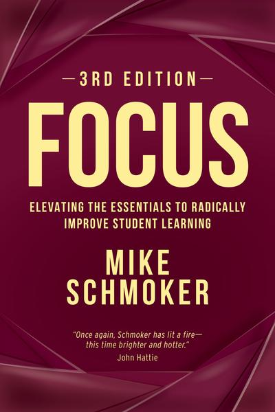

# Do It Again

*On exhausted teachers, suspiciously quiet classrooms, and the possibility that learning was interesting all along.*

**David Hepting · Lifeplus Workshop · November 2026**

## I. The best-educated person in the room

> **“Take a simple idea and take it seriously.”** — attributed to Charlie Munger [10]

Almost every lasting improvement in my teaching has come from taking a few simple ideas seriously. This workshop is based on a small handful of those ideas. 

Over the years I kept trying to figure out the single most important skills in the classroom that will prepare for future success. What can students do repeatedly in my class that is transferable to almost any field in their future? What follows is not a perfect list, but it's the three most valuable skills I've come up with so far: **Remember stuff. Generate questions. Write well.** Their simplicity is almost suspicious. They become demanding enough as soon as we try to do them well. QFT and Copywork are two of the central routines that help us practice them. What follows is a snippet of my own journey of discovery into these ideas. 

I had big dreams as a new teacher.

Every class would be fun, engaging, and different. Students would arrive expecting challenging ideas, surprising connections, and activities that made them forget to check the clock. I would make learning come alive.

Then I started teaching, and began to suspect that learning and I could not both remain alive on this schedule.

My first year teaching was in Stanley Mission, an Indigenous reservation in northern Saskatchewan. Attendance was patchy. Many students struggled with the academic work, but what troubled me most was their conviction that they could never become good at it. I was brand new. Families who wondered whether I knew what I was doing had identified a legitimate research question.

Much of my repertoire involved interesting texts, web tools, and inventive activities. Students did not have devices. The Wi-Fi was patchy. The printer often did not work. It is difficult to deliver the classroom of the future when the classroom of the present cannot produce a worksheet.

I remember putting a lot of effort into a math lesson involving pebbles. We went outside to find stones and use them for calculations. I imagined discovery, closeness with nature, movement, and mathematics becoming tangible. Instead, many students became distracted and talked or walked away. I had brought the class outside. I had not necessarily brought them any closer to understanding the math.

The pebbles were a small instance of a larger problem. Over the first year or two of teaching, I kept trying to make each lesson new. When I devoted the time needed to make one class exceptional, the other four or five classes received what remained of me. Tomorrow, some other class would get its turn at exceptional. I was operating on a rotating shortage of educational brilliance.

Even a promising activity could consume half its energy in explanation. Here are today’s instructions. Here is how the groups work. Here is what you do with the cards. No, the other cards. Students were repeatedly learning how to participate in my latest invention. The ideas I wanted them to learn had to wait for the instructions to finish.

I worked hard. They learned much less than I hoped. I became overwhelmed, discouraged, and increasingly burnt out.

Eventually, I discovered a principle that began to change the question I was asking:

> **The one who does the work gets the learning.**

I had been finding the interesting material, making connections, anticipating objections, organizing explanations, and inventing questions. Naturally, I was learning a tremendous amount.

The students were just passively receiving all of my conclusions. 

They were receiving the finished product of thinking I had already done. I had confused the work a lesson required of *me* with the thinking it required of *them*.

The principle didn't mean abandoning explanation or leaving students stranded. It was a question about where the intellectual work was happening. **Who was recalling, choosing, connecting, questioning, and trying to put an idea into words?**

Once I started asking that, other things began to fall into place.

During my teacher training, a Grade 5 teacher confided in me  "The only thing standing between me and chaos are routines". She had a routine for everything so students knew exactly what to do at any moment. I had privately filed this under *excellent advice for people teaching younger children*. But my high school classes would be so engaging that we would rise above such administrative concerns.

It turns out adolescence does not abolish the need to know what is happening.

Routines gave students a familiar way into the work and gave me a way out of continually manufacturing a new event. Less explaining procedures. Less confusion. More learning.

**Everything routine becomes easy.** Or at least easier: the steps that once consumed our attention become familiar enough to leave room for harder thinking. A class that struggles to frame one worthwhile question can learn to produce twenty. Expertise grows partly by making yesterday’s demanding work today’s starting point.

Mike Schmoker’s *Focus* helped give this change a direction: worthwhile curriculum, sound instruction, and serious attention to reading and writing.[7] The rhythm or routine I came to value was simple:

*[*Focus*, third edition — Mike Schmoker. Cover: ASCD.](https://www.ascd.org/books/focus-3rd-edition?variant=126031)*

**Read. Think. Discuss. Write.**

This routine reaches back millennia. It has proven incredibly adaptable. The text could change. The difficulty could increase. The ideas could become stranger and more demanding. 

But there was still the matter of boredom.

In G. K. Chesterton’s *Orthodoxy*, a child asks for a delightful thing to happen again and again, while the adult tires of supplying it. He suggests perhaps God too can “exult in monotony.” Perhaps the daily return of the sun expresses delight (Do it again!) rather than mechanical exhaustion. He makes every daisy alike because he has never grown tired of them. Perhaps “we have sinned and grown old and our Father is younger than we.”[1]

*[*Orthodoxy* — G. K. Chesterton. Dover edition cover.](https://www.target.com/p/-/A-77730286)*

I find this one of the most profound ideas I have encountered. **Repetition need not mean that the possibilities have been exhausted. It may mean we have found something worth returning to.**

## II. Generate questions: please stop answering for a moment

By the time I encountered the Question Formulation Technique, I was ready for it.

Here was a routine that moved one of the most interesting parts of teaching into students’ hands. They would make the questions.

I immediately knew it was golden.

Teachers are practiced question-makers. We can build an entire discussion around a sequence of prompts designed to lead students toward a discovery we have already made. This can be excellent teaching. It can also become a guided tour in which the guide asks everyone to guess the next exhibit.

Dan Rothstein and Luz Santana’s QFT offers another arrangement. Give students a stimulus: a statement, image, object, or passage. Ask them to generate questions. During this stage, they must not stop to answer, judge, or discuss them. Then they examine the questions, distinguish open from closed, convert some, choose priorities for a purpose, and decide what to do next. Finally, they reflect on the process.[6]

*[*Make Just One Change* — Dan Rothstein and Luz Santana. Cover: Harvard Education Press.](https://hep.gse.harvard.edu/9781612500997/make-just-one-change/)*

The prohibition on answering is particularly inconvenient for teachers, since many of us entered the profession with an impressive collection of answers and would like someone to appreciate them.

But an answer can close a space before a student has had time to explore it. Letting questions accumulate makes room for a different starting point, an unexpected uncertainty, a connection the teacher did not prepare. You can almost feel the curiosity build up in the room as they want to start answering right away and talking about their favourite questions. It feels more like improv than scripted theatre because you never quite know where their curiosity will lead next.

A stimulus such as *A character can do the right thing for the wrong reason* can open several paths. Students’ questions should then guide reading, investigation, discussion, or an argument.

Otherwise, we have given them a steering wheel connected to nothing. This is an excellent toy for a toddler and a disappointing model of intellectual agency.

The teacher still matters enormously. Someone chooses interesting and important material, makes it accessible, teaches missing knowledge, and insists that answers be supported. **The work has been redistributed, not wished away.**

From the outside this might look boring. Yet beneath the quiet, students are interpreting, comparing, doubting, and trying to make themselves understood.

The text helps because it can wait. A student can pause, reread a sentence, check a word, and return to an earlier claim. My spoken explanation moves at my pace; a text lets students move at theirs. **Some differentiation happens automatically when students control the pace of reading.** One pauses over a difficult sentence while another follows a connection. Neither needs me to adjust the speed of my mouth.

Reading still needs support. So does questioning. But a repeatable structure gives students a place to practice both, without first learning the rules of another activity.

The Grade 5 teacher had been right. The astonishing thing was that a routine could make a lesson *less* predictable: once students knew the procedure, their thinking had more room to surprise me.

## III. Write well: the scandal of someone else’s sentences

**Should students practice good writing—or mediocre writing?**

For good reason we want to steer clear of plagiarism, of copying others and presenting it as our own. We want to preserve student voice. For a host of good reasons, we have largely stopped copying and imitating great writing. But have we lost something along the way?

Other fields are less embarrassed about imitation. Renaissance apprentices spent years in workshops learning their craft, including copying drawings and studying their masters’ methods before establishing independent careers.[11] They were not expected to invent painting on Monday. **Imitate, then innovate.**

We happily ask young musicians to play somebody else’s music. We do not insist that beginners discover the violin by expressing their authentic relationship with catgut. In athletics students learn by imitating the best, again and again and again. Yet in writing, we sometimes regard copying a model as an unfortunate interference with the student’s voice.

Benjamin Franklin approached the problem by studying essays in *The Spectator*. He made brief notes on their ideas, put the originals away, and later tried to reconstruct them. Then he compared his version with the model and corrected weaknesses. He also turned prose into verse and back to expand his command of words, and shuffled his notes to practice arranging ideas.[2]

He had built himself a small writing laboratory: a model, an attempt, a visible discrepancy, another attempt. His errors had somewhere useful to go.

Franklin was reconstructing rather than simply transcribing. Joan Didion took a more literal route. She recalled teaching herself to type by typing the beginning of Hemingway’s *A Farewell to Arms* and a couple of his short stories; she also described learning from Hemingway how sentences worked.[3]

Typing a sentence makes its decisions arrive one at a time. This word. Then this one. A clause that continues longer than expected. A sentence that stops before you thought it would.

Brett and Kate McKay’s essay on copywork makes the case for examining word choice, syntax, punctuation, and paragraph structure; Brett’s legal-training example involves reconstructing strong memos from notes, borrowing professional reasoning as well as prose.[9]

**Copywork can make excellent writing available for inspection.** It gives a student something more concrete than “improve your style,” an instruction approximately as actionable as “be more impressive.”

Take this original example:

> *The clock swallowed our last minute.*

Time has acquired an appetite. The verb makes the deadline feel like an active threat. A student can identify that choice, explain its effect, and attempt it elsewhere:

> *The inbox swallowed my quiet morning.*

Now the student has done more than identify personification. They have taken a technique somewhere new and can judge whether it belongs there.

The movement I want is **copy → notice → explain → try**. Copy accurately. Notice a precise choice. Explain what it does in this passage. Use the technique for a meaning of your own.

That can involve a striking image, but it can also involve the placement of evidence, a clear distinction, or the way a paragraph anticipates an objection. A lucid explanation is as worthy of study as a beautiful description. Sometimes the most impressive thing a sentence does is leave the reader knowing exactly what it means.

Copying is not magic. A hand can move while its owner is somewhere else. Explanation, feedback, and a new attempt turn the model into practice for independence. **The aim is independence; the route need not begin with isolation.**

And notice another feature of Franklin’s routine. He put the original away. He waited. Then he tried to bring something back.

## IV. Remember stuff: what comes back tomorrow?

Students were asking better questions, reading more closely, and writing more. Yet something thoroughly learned on Tuesday could return a month later wearing a disguise. I knew the feeling from Chinese: recognize a word instantly, then fail to produce it thirty seconds later. Reading about the science of learning made me ask a different question: how could I help learning last?

Enter Hermann Ebbinghaus, a nineteenth-century researcher willing to spend an extraordinary amount of time learning material nobody would otherwise wish to remember. He made himself both investigator and experimental subject, learning lists of nonsense syllables, waiting, and measuring how much work he saved when relearning them. Removing meaningful connections helped him study memory under controlled conditions, though it made his reading list exceptionally poor company.[12]

His **forgetting curve** showed a steep initial loss followed by slower forgetting. After 31 days, his relearning savings were about **21%**: learning the material again took roughly four-fifths of the original effort. That does *not* mean students remember exactly 21% of a lesson after a month; he was measuring relearning savings for nonsense syllables, not classroom recall. But the question it raised for me was alarming enough: *how much of the learning I was celebrating would still be available a month later?*[12]

I hate wasting time. Discovering that a successful lesson could be followed by a thoroughly successful disappearance was not cool. I wanted students to know these things long term!

That became another revolution in my teaching. **Remembering is a learnable skill.** It deserved a place in the design of my classes, rather than a disappointed comment at the end of the term.

A few ideas from cognitive science began to change what I asked students to do. **Active recall** meant bringing an answer back before looking, then checking and correcting it.[4] **Spaced repetition** meant returning to learning after gaps across days and weeks, rather than spending all the practice in one sitting.[8] **Interleaving** meant mixing related kinds of problems once students knew the basics, so they had to choose the approach as well as carry it out.[4]

These ideas changed the timetable: earlier vocabulary returned, old questions joined new ones, and yesterday’s concept appeared in a different text. A spiral should take students somewhere. Otherwise it is merely going around in circles with better stationery.

As I was learning Chinese, I discovered **Anki** and began reading success stories. These three capture what excited me—and the question they raised: *what could this mean for my own classes?*

**A 355-day streak—and the top 5% of medical school.** After an undergraduate GPA of about 3.1, one learner reported finishing their first medical-school year in the top 5%, with scores of 97+ in every class. Their routine combined lectures, practice questions, and a 355-day Anki streak.[14]

**Around 15,000 Russian words.** One learner reported progressing from A1 to C2 Russian with approximately 15,000 words. They credited part of that progress to daily reading, adding unfamiliar words to Anki, and completing reviews.[15]

**Eighteen months and around 3,000 Bengali words.** Another learner reported consistent Anki use for a year and a half, building that vocabulary and becoming able to hold basic conversations. The words were becoming something they could use with another person.[18]

These are self-reported successes, with other learning and practice involved. But a stronger medical student, thousands of Russian words, and conversations in Bengali were a rather interesting range of possibilities for a flashcard app. What if my students could keep accumulating knowledge instead of repeatedly discovering that last term had been wiped from the premises?

Anki made returning to learning a daily habit. Its **FSRS—Free Spaced Repetition Scheduler—** uses review history to personalize when cards return toward a chosen retention target, with higher targets requiring more reviews.[13] The software handles the appointments; I still have to turn up and think. Review what needs attention; let securely remembered words wait longer. 

A 2011 study at the **University of British Columbia** gave me another way to think about where the power of a lesson resides. Two large physics sections covered the same objectives over one week. One had an experienced, highly rated lecturer. The other had a postdoctoral researcher and a graduate student whose teaching experience had been limited to assisting, but who had training in research-based instruction. Their students prepared with short readings and quizzes, reasoned through questions with peers, worked on small-group tasks, and received frequent feedback.[17]

On the test immediately following the unit, the interactive class averaged **74%, compared with 41%** in the lecture class. This tested a package of active-learning practices over a week, not recall alone or retention months later. Still, the result was a useful disturbance to my assumptions: the less experienced teachers had organized more productive thinking for the students. The one who does the work gets the learning had turned up again, this time in a physics department.[17]

Natalie Wexler’s *The Knowledge Gap* helped me see why keeping knowledge matters: comprehension depends partly on the knowledge and vocabulary the reader brings.[5] **What you remember is available to think with.** Memorization is sometimes treated as the embarrassing relative in the educational family. Yet critical thinking would have very little to discuss without it.

*[*The Knowledge Gap* — Natalie Wexler. Cover: Penguin/Avery.](https://www.penguin.com.au/books/the-knowledge-gap-9780735213579)*

And **metacognition** meant teaching students to plan their learning, check what they could actually retrieve or apply, and adjust their approach instead of trusting the feeling of familiarity.

I had spent too much time assuming that telling students to study meant they knew how. We search for the silver bullet that works across subjects while leaving learning itself strangely untaught. These habits can travel into another class, a new language, or a future profession, provided students learn how to adapt them to the work. We can teach them explicitly—and organize our classrooms so students practice them every week.[4]

The three skills now give me a test for a lesson: **Who is remembering? Who is generating questions? Who is writing?** A classroom can be quiet while all three are happening, and lively while very little of any of them occurs.

I would not go back to Stanley Mission with a laminated routine and announce that I had solved attendance, trust, or the lack of resources. That year was difficult in ways no procedure could make simple. Nor do I think every enjoyable activity conceals an educational fraud. There is still room in the world for pebbles.

But I would bring a different question: **what work will help these students experience themselves becoming more capable?**

That is the interest I was trying so hard to manufacture. Understanding something that was confusing. Remembering a word when it is needed. Asking a question that changes the discussion. Writing a sentence worth reading twice.

**Learning is its own reward.** I keep trying to make the enjoyment of improvement and sharing ideas the main motivation. In my classes, presentations worth no marks sometimes receive more effort than assignments worth 30%. Students want to know something and share it; there is less pressure to calculate what it is worth. The work can become more interesting when it stops auditioning for a grade.

Chesterton’s child wants the delightful thing again. The adult worries that it has already been done. The classroom offers a reason to reconsider: we can return to a familiar practice with more knowledge, more fluency, or a question we did not have yesterday.

Take a simple idea seriously enough to put it on tomorrow’s timetable. Then give it the chance to become a routine.

Tomorrow, we can read, think, discuss, and write again.

I may even have time to prepare for my other classes.

---

## Here is how I use the routines

### Read, Think, Discuss, and Write

Here is what the routine looks like in my classroom, using **Learning is Fun**:

1. **Post the text.** I put the reading in the Learning is Fun app so everyone has access to the same material.  

2. **Read and generate questions.** Students read at home or in class. Together, we aim for **20–25 questions** about the text as a class total. **No replies yet:** the job is to notice, wonder, and ask. Even the student with an excellent answer has to keep it warm for a moment.

3. **Vote to prioritize.** Each student gets **three votes, one each for three different questions**. Choose questions that will deepen our understanding of the text. The class’s priorities rise to the top.

4. **Write replies.** Students respond to at least **two or three questions**. If choosing becomes a barrier, I click **Assign Questions**: the app works down from the highest-voted questions and assigns one to each student. Ideally these discussions can lead into more developed writing for major assignments based on the texts they have read. 

In a recent class, students **read the text, generated 20 questions, and wrote 25 replies in about 45 minutes**. That was more questions and responses than I had ever managed in an oral discussion in the same amount of time. The amount of thinking made visible was striking. It has also made an incredible difference with shy classes. Students who rarely speak in my classes often contribute readily in writing. 

The teacher no longer had to be the switchboard through which every contribution passed. Students could think and write simultaneously, then respond to one another’s ideas.

This discussion routine draws on QFT; voting provides our prioritization step. For full QFT, also identify open and closed questions, discuss their uses, convert examples in both directions, explain priority choices, and reflect.[6]

**Four rules while generating questions:** ask as many as possible; pause judgment, discussion, and answers; record each question in the speaker’s own words; turn statements into questions.[6]

### Active Recall — Flashcards

1. **Six to eight new words each week.** Students receive the words automatically through the Learning is Fun app. I have chosen the vocabulary for the whole year in advance, so I never need to worry about what comes next. Students get access to each week’s words on the **Friday of the week before**.  

2. **A vocabulary presentation in the first class period.** I have an AI skill that produces a presentation each week, exactly how I like it, based on that week’s words. We work through the presentation in the first class period; in the second, they get the…  

3. **Quiz!** I have already automatically created the quizzes for the entire year, for every class. They are marked automatically, so I do not need to mark them or enter those marks manually. Students know the routine, so there are no surprise quizzes and less to feel nervous about.

**Daily flashcards:** the app schedules up to **20 reviews a day, when needed**, using FSRS-based scheduling. Students attempt recall before revealing each answer and rate it honestly. Well-remembered words return less often; keeping up with the schedule prepares students for the quizzes.

Each quiz gives students another opportunity to recall the words. **Sixty percent covers that week’s vocabulary; forty percent draws from anywhere earlier in the year.** They therefore need to keep reviewing earlier words, with the aim of knowing them incredibly well by the end of the year. Tests, episodes and the final exam also draw on that vocabulary.

**The routine combines active recall with spaced review:** meet the words, work with them, retrieve them, and keep encountering them throughout the year.

### Copywork Analysis Portfolio

Every two weeks, students copy from a model essay and write original paragraphs that fit its structure and argument. The balance shifts toward independence:

**Quarter 1:** copy 5 paragraphs; write 1. **Quarter 2:** copy 4; write 2. **Second semester:** copy 3; write 3.

Each time, underline and explain **three writerly moves**, borrow and label **at least one** in the original writing, and use **two additional, distinct thinking moves** from the provided menu. Box the original paragraphs. The full assignment, menu, and rubric are under **Workshop links**. This is my first year using it; the work is challenging, but students are improving through regular encounters with excellent writing.

### Episodes

Animations, pictures, and an immersive adventure help ideas come alive. Students who avoid other work will sometimes play these stories several times. Chinese episodes also offer interactive language practice.

1. **Play the adventure.** Encounter ideas through the story and its interactions.

2. **Retrieve and reflect.** Complete the multiple-choice check and, where included, a short writing response.

3. **Check the attempt data.** Repeated attempts may suggest guessing; they are a clue, not proof. Use them to decide who needs a closer look.

### Lessons

Lessons let students **learn a skill, get instant feedback, and progress at their own pace** through explanations, models, practice, and revision. Texts supply something worth discussing; Episodes give ideas a story; Lessons help students practice doing something well.

## A few ideas to take seriously

**Remember stuff. Generate questions. Write well.** Give these three skills a substantial share of class time.

**The one who does the work gets the learning.** Who is recalling, connecting, questioning, and composing?

**Read. Think. Discuss. Write.** Keep the structure familiar; let the ideas become more demanding.

**Everything routine becomes easy.** Make worthwhile thinking familiar enough to free attention for the next challenge. Repetition can mean we have found something worth returning to.

**We learn best by doing.** Give students guided practice in the actual work of the field.

**Imitate, then innovate.** Copy → notice → explain → try. Inspect excellent writing, then use what you notice. The aim is independence.

**Remembering is a learnable skill.** Retrieve before looking; return after a gap; mix related problems. What you remember is available to think with.

**Structure provides differentiation.** Let them control reading pace, generate questions, and pursue answers at their level. Follow their own curiosity. 

**Learning is the reward.** Make the enjoyment of improvement and sharing worthwhile ideas the main motivation. In my classes, reducing the pressure of marks can give that enjoyment more room. 

## Learning is Fun: make it easier to do again

### Create

**Texts:** upload or paste a reading and assign it. Built-in discussion tools let students generate questions, vote, and write replies around the text.

**Lessons:** teach a skill through explanations, models, practice, instant feedback, and revision at each student’s pace.

**Episodes:** create illustrated, animated adventures with comprehension checks and optional writing reflections. Chinese episodes support language practice.

### Small Features

**Class timers:** give reading, copywork, or question generation a clear, beautiful countdown.

**Make groups:** organize students for collaborative work.

**Pick a student:** use the spinning wheel after thinking or rehearsal time to broaden participation.

### Remember

**Flashcards:** attempt recall before revealing the answer, then rate it for spaced review. Open a deck online first; its cards can then be reviewed on that device offline. Reconnect to sync. Students can install the app on a phone or laptop while online, then use downloaded cards offline. 

**Practice quizzes:** students choose *Generate Practice Quiz* to practice from their class’s flashcards.

**Teacher quizzes:** build or generate a draft, check its questions and answer key, then publish.

### Organization

**Weekly materials:** keep assigned texts and other class materials organized by week.

**Today’s Notes:** give students one place to find instructions and reminders.

**Links and resources:** keep useful materials available to revisit. Planning and progress tools help decide what needs another look.

### Try it out!

Activate **Teacher access** with David’s invitation. Create one class under **Classes** and find its join code. Under **Texts → Add a Text**, add and assign one reading. Then choose **Discussions → Start discussion → Text discussion** and select it.

Use the same account for the workshop and your teaching. The workshop class code enrolls you; the separate teacher invitation enables teaching tools.

### Workshop links

[Join / reopen workshop](https://zumboggo.github.io/Learningisfun/#/workshop) · [Teacher access](https://zumboggo.github.io/Learningisfun/#/teacher-access)

[LIF walkthrough guide](https://zumboggo.github.io/Learningisfun/#/texts/wg_e34f03900e9494d9168dc5b13fd567dd?classId=5a726282-4771-4774-8213-d9329c124bbc)

[Copywork assignment & rubric](https://zumboggo.github.io/Learningisfun/#/texts/ws26-rubric?classId=5a726282-4771-4774-8213-d9329c124bbc)

[Interactive Copywork lesson](https://zumboggo.github.io/Learningisfun/#/lessons?workshop=5a726282-4771-4774-8213-d9329c124bbc)

[Sample QFT & Copywork flashcards](https://zumboggo.github.io/Learningisfun/#/decks/ws26-copywork-qft-cards/review?workshop=5a726282-4771-4774-8213-d9329c124bbc)

On paper: open zumboggo.github.io/Learningisfun/ and find the resources in the Lifeplus Workshop class.

Contact: [david.hepting@cdischina.com](mailto:david.hepting@cdischina.com)

## Sources and further reading

**[1] G. K. Chesterton.** [*Orthodoxy*](https://www.gutenberg.org/files/16769/16769-h/16769-h.htm) (1908).

**[2] Benjamin Franklin.** [*Autobiography*](https://dev.gutenberg.org/cache/epub/36151/pg36151-images.html).

**[3] Joan Didion.** [Academy of Achievement interview](https://achievement.org/achiever/joan-didion/); [“The Art of Fiction No. 71,” *The Paris Review*](https://www.theparisreview.org/interviews/3439/the-art-of-fiction-no-71-joan-didion) (1978).

**[4] John Dunlosky.** [“Strengthening the Student Toolbox,”](https://www.aft.org/ae/fall2013/dunlosky) *American Educator* (Fall 2013).

**[5] Natalie Wexler.** [*The Knowledge Gap*](https://nataliewexler.com/the-knowledge-gap/) (2019).

**[6] Dan Rothstein & Luz Santana.** *Make Just One Change: Teach Students to Ask Their Own Questions* (2011). [QFT process and resources, Right Question Institute.](https://rightquestion.org/what-is-the-qft/). QFT created by Dan Rothstein and Luz Santana, co-founders of the Right Question Institute.

**[7] Mike Schmoker.** [*Focus: Elevating the Essentials to Radically Improve Student Learning.*](https://www.ascd.org/books/focus-3rd-edition?variant=126031).

**[8] Australian Education Research Organisation.** [Spacing and retrieval practice guide.](https://www.edresearch.edu.au/guides-resources/practice-guides/spacing-and-retrieval-practice-guide-full-publication).

**[9] Brett & Kate McKay.** [“Want to Become a Better Writer? Copy the Work of Others!”](https://www.artofmanliness.com/finance/career/want-to-become-a-better-writer-copy-the-work-of-others/).

**[10] Charlie Munger attribution.** [Munger Archive](https://mungerarchive.com/quotes/). Common attribution; exact wording unverified.

**[11] Renaissance workshops.** [World History Encyclopedia](https://www.worldhistory.org/article/1611/life-in-a-renaissance-artists-workshop/).

**[12] Jaap Murre & Joeri Dros.** [“Replication and Analysis of Ebbinghaus’ Forgetting Curve”](https://journals.plos.org/plosone/article?id=10.1371/journal.pone.0120644), *PLOS ONE* (2015).

**[13] Anki manual.** [FSRS and deck options](https://docs.ankiweb.net/deck-options.html#fsrs).

**[14] Reddit testimony, medical study.** u/SnooRobots8665, [“How I succeeded during first year as an osteopathic medical student: Anki, structure, and efficiency”](https://www.reddit.com/r/medicalschoolanki/comments/1uaee0b/how_i_succeeded_during_first_year_as_an/).

**[15] Reddit testimony, Russian learning.** u/OjisanSeiuchi, [comment in “Anki success stories”](https://www.reddit.com/r/Anki/comments/ubbdoc/comment/i64247a/) (2022).

**[16] Benedict Carey.** [*How We Learn: The Surprising Truth About When, Where, and Why It Happens*](https://www.penguinrandomhouse.com/books/221559/how-we-learn-by-benedict-carey/9780812993899/) (2014).

**[17] Louis Deslauriers, Ellen Schelew & Carl Wieman.** [“Improved Learning in a Large-Enrollment Physics Class”](https://hub.williams.edu/teaching-center/files/2023/09/Deslauriers-et-al.-2011.pdf), *Science* 332 (2011).

**[18] Reddit testimony, Bengali learning.** u/darogababu08, [comment in “Anki success stories”](https://www.reddit.com/r/Anki/comments/ubbdoc/anki_success_stories/) (2022).

Personal experiences are David’s recollections; Reddit accounts are anecdotes. LIF features vary by role and class. Review generated material before assigning it.
