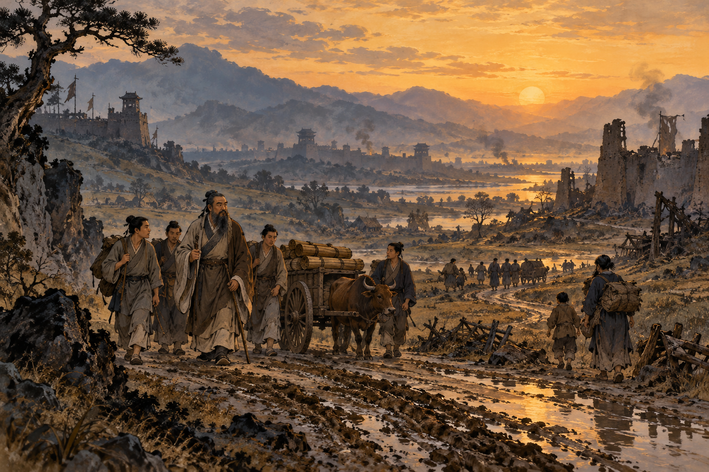
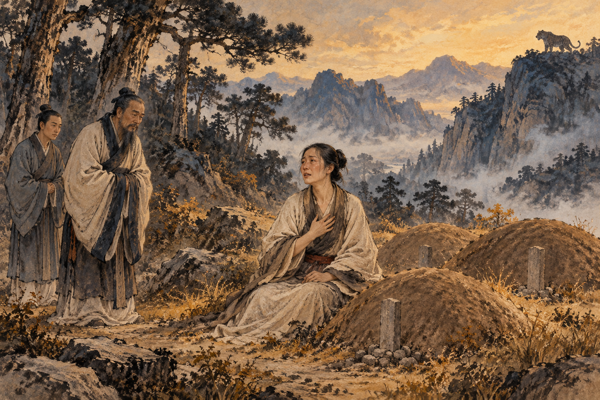
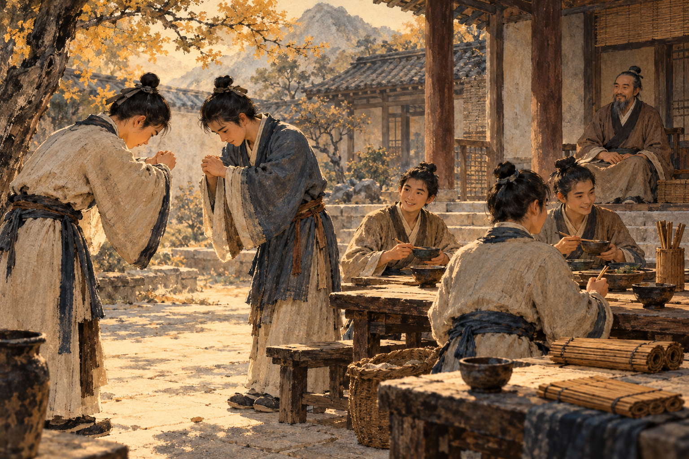
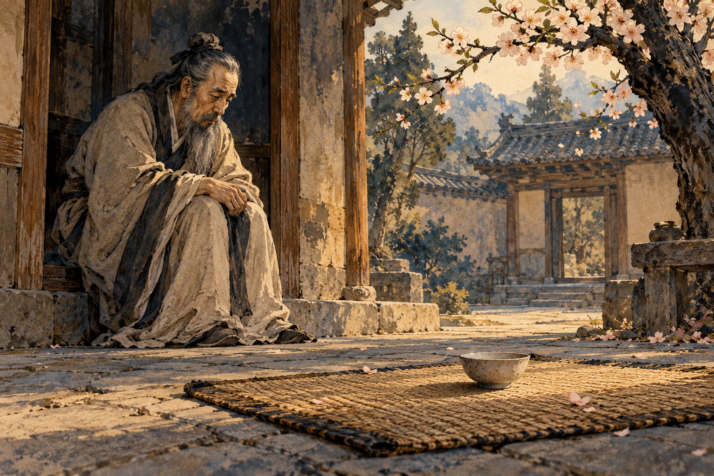

# History of Ethics in China — Part 1: The Teacher and the Tiger

The woman had already lost her father-in-law to a tiger. Then her husband. Now her son was dead too.

According to a story preserved in the *Book of Rites*, Confucius encountered her crying beside a grave near Mount Tai. He sent a disciple to speak with her. After hearing what had happened, the obvious question was why she stayed. Surely there had to be somewhere safer than a neighborhood in which a tiger was working its way through the family.

Her answer was that the government here was not oppressive.

Confucius told his students to remember it: harsh government could be more terrible than a tiger. This is an ancient teaching story, not a verified report of a particular afternoon. But whoever preserved it understood something about political power. A tiger could kill someone. A government could take a harvest, demand a son's labor, send him to war, and punish the family when it could not pay. Moving away from the animal might mean moving toward something worse. [1]

*An imagined scene of the world through which Confucius traveled; AI-generated illustration.*

## A world with too many rulers

Confucius, or Kongzi, lived from 551 to 479 BCE, in the later part of the Spring and Autumn period. He came from Lu, in what is now Shandong. There was a Zhou king, but royal authority no longer held the political world together as it once had. Regional rulers and powerful families competed for territory, wealth, and influence. Confucius lived before the Qin empire unified much of this territory in 221 BCE. The China of his lifetime was a landscape of rival states, not one modern nation with one government. [2]

That distinction matters because his proposals were addressed to people who could do something immediate with them. A ruler could reduce demands on farming families. A minister could refuse a dishonest order. A powerful household could stop pretending that its private ambitions were the needs of the state.

Confucius wanted a place in government where he could put his ideas to work. He traveled, taught, advised, and experienced disappointment. The enormous authority attached to his name came largely afterward. During his lifetime, he was a teacher trying to convince powerful people that becoming better people was part of their job.

This was not necessarily what they had hoped to hear. A visiting expert who promised more territory might be welcome. One who suggested that the ruler himself needed improvement was offering a less comfortable service.

The conversations associated with Confucius were gathered by later followers in the *Analects*. It is a collection of remarks, encounters, and memories, rather than a book he sat down and wrote from beginning to end. Its teacher can be demanding, funny, disappointed, affectionate, and difficult to satisfy. He is much more interesting than the solemn statue. [2, 3]

## Becoming someone other people can live with

One of his central words is **ren**, usually translated as humaneness or benevolence. Translation is awkward because the word does more work than “being nice.” Ren concerns the quality of someone whose conduct takes other people seriously.

There is a practical difference between liking humanity and noticing the person carrying the heavy basket beside you. The first can be accomplished while remaining comfortably seated. The second may require getting up. That is a modern illustration, but it captures why this tradition spends so much time on conduct.

Confucius repeatedly connects character with **li**: ritual, propriety, and the appropriate forms of social life. These include ceremonies, but also greetings, mourning, hospitality, and ways of showing respect. At first this can sound like a proposal to solve political disaster by improving everyone's table manners.

The connection is more substantial. Repeated actions train attention. Giving someone time to speak, acknowledging a guest, or treating grief with care can become a habit. Such habits make concern visible and dependable. They also give people a language for expressing feelings when improvising would be difficult.

But ritual can go empty. An expensive funeral may display the family's wealth more clearly than its love. A beautifully performed greeting can conceal contempt. In the *Analects*, Confucius challenges the value of ritual and music when the person performing them lacks humaneness. The bow alone is not the achievement. [3]

*The tiger story from the Book of Rites, interpreted imaginatively; AI-generated illustration.*

The person working toward this combination of humane feeling and practiced judgment is a **junzi**. The word had associations with noble birth, but in the *Analects* it becomes a demanding ideal of character. “Exemplary person” is a useful translation. A title could be inherited; the conduct still had to be earned.

Another important word is **yi**, often translated as rightness or righteousness. It concerns what is fitting and morally appropriate, rather than simply profitable. A ruler might gain territory through betrayal. A merchant might make money by exploiting someone's desperation. Success at getting the desired result does not settle whether the action was right.

This makes **self-cultivation** a serious undertaking. People become more reliable through learning, reflection, relationships, and repeated practice. The aim is not to memorize enough moral vocabulary to sound impressive at dinner. It is to become someone who behaves better when dinner is over and nobody important is watching.

## The family is where it starts—and where it gets complicated

**Xiao**, filial piety, concerns the obligations children have toward parents and ancestors. Confucius insists that merely feeding a parent is not enough. Animals are fed too. The human difference involves respect and the manner in which care is given. [3]

Here is an ethical tool with lasting reach: begin with relationships in which another person's needs are already close enough to disturb your convenience. A sick parent cannot be helped by a general statement supporting the elderly. Somebody has to do the work.

Yet family loyalty creates difficulties. In one *Analects* passage, a local governor praises a son who reported his father for stealing a sheep. Confucius replies that uprightness in his community includes fathers and sons concealing one another's wrongdoing. The text does not tell us what happened to the sheep's owner. That absence is part of what makes the exchange so uncomfortable. [3]

It would be too easy to turn this into a tidy slogan about family values. Protecting intimate trust can also protect a wrongdoer. Conversely, a society that expects every child to act as an investigator against a parent may damage something valuable. Confucian ethics brings the claims of relationships into view without making every collision between them disappear.

Nor does respect always mean silent agreement. Confucius also describes gently correcting parents. Later Confucian thinkers argue more forcefully that following what is right can require resisting a parent or ruler. This tradition contains arguments over obedience, not one instruction endlessly repeated. [3, 4]

## What a ruler owes the ruled

The same pattern reaches government. Confucius describes the ruler's influence through **de**, moral character or virtue with the power to shape others. People learn from what leaders reward, excuse, and do themselves. A ruler who praises honesty while rewarding flattering lies is teaching a very clear lesson. The official speech is merely competing with it.

In the *Analects*, government by punishment is contrasted with government through virtue and ritual. Punishment may make people avoid penalties; it does not necessarily make them care about doing right. This is not a claim that every person will become good if the ruler smiles warmly. It is a claim that fear and moral formation produce different kinds of behavior. [3]

The **rectification of names**, or **zhengming**, adds another demand. Names and roles must connect with reality. A ruler should act as a ruler ought; a minister should actually perform the responsibilities of a minister. The concept has several interpretations, including concerns about political legitimacy and the proper use of language. Its practical force is that an impressive label cannot do the work of the thing it names. [3]

*Ritual as everyday practice rather than spectacle; AI-generated illustration.*

This remains a hierarchical picture of society: people occupy unequal positions, with unequal duties. It is not a modern theory of equal political rights. Later formulations of the **five relationships**—parent and child, ruler and minister, husband and wife, older and younger, and friends—made these relational responsibilities particularly influential. The gender hierarchy could sharply restrict women's lives. Duties of care did not cancel those inequalities. [4]

But the ruler is also placed under an ethical description. “I am in charge” and “I am governing well” become different claims. The woman near Mount Tai makes the distinction brutally concrete. Whatever a government calls itself, its subjects may experience it as the thing they fled.

## A bowl of rice and an empty place

Confucius's favorite disciple, Yan Hui, lived with very little. The *Analects* remembers his plain food, simple dwelling, and continuing delight in learning. Confucius admired him. When Yan Hui died, the teacher's grief was intense. Others remarked that it was excessive. He did not respond by producing a polished statement about the appropriate emotional response to loss. [3]

The collection also remembers a student asking for one word that could guide a life. Confucius offers **shu**, often understood as reciprocity or the effort to consider another person's position. He connects it with not imposing on others what one would reject for oneself. This is a portable tool, but it requires imagination. Another person's fear or humiliation is easy to overlook when it arrives dressed as a small inconvenience to you. [3]

The teacher who cared about formal mourning also mourned a particular person. The student who appeared in his hopes was gone. The little bowl and the poor dwelling did not become grander because later generations would remember their owner.

Confucius had tried to teach powerful men how to become humane. Some listened; many did not. His followers preserved the conversations. Alongside the advice about rulers and ritual, they kept the grief.

*An imagined memorial to Yan Hui; AI-generated illustration.*

## Sources

[1] *Book of Rites*, “Tan Gong II,” tiger story; context and passage at [Key Concepts in Chinese Thought and Culture](https://www.chinesethought.cn/EN/shuyu_show.aspx?shuyu_id=4061).

[2] [Stanford Encyclopedia of Philosophy: Confucius](https://plato.stanford.edu/entries/confucius/).

[3] *Analects*, especially 2.3, 2.7, 3.3, 4.16, 4.18, 6.11, 11.9–10, 12.11, 12.19, 13.3, 13.18 and 15.24. [James Legge's public-domain translation](https://www.gutenberg.org/cache/epub/3330/pg3330-images.html). Explanations above are original paraphrases, not quotations from a single translation.

[4] [Stanford Encyclopedia of Philosophy: Chinese Ethics](https://plato.stanford.edu/entries/ethics-chinese/), on relationships and remonstration; [Gender in Confucian Philosophy](https://plato.stanford.edu/entries/confucian-gender/).
