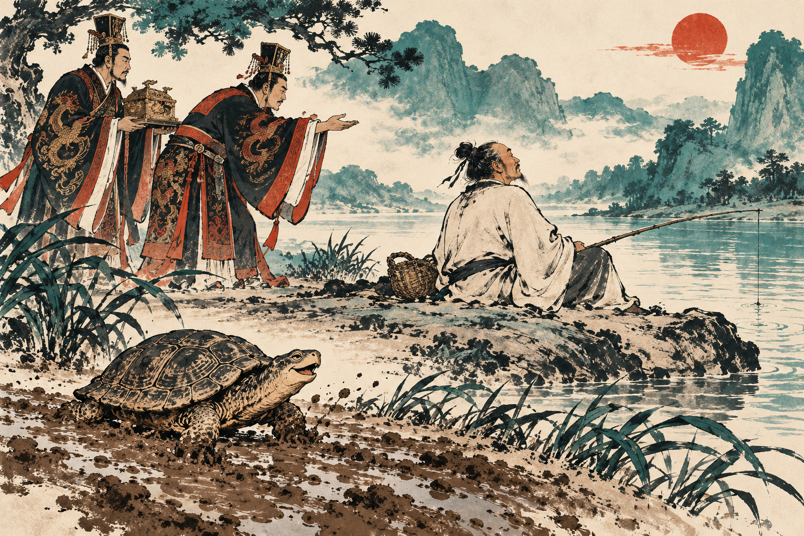
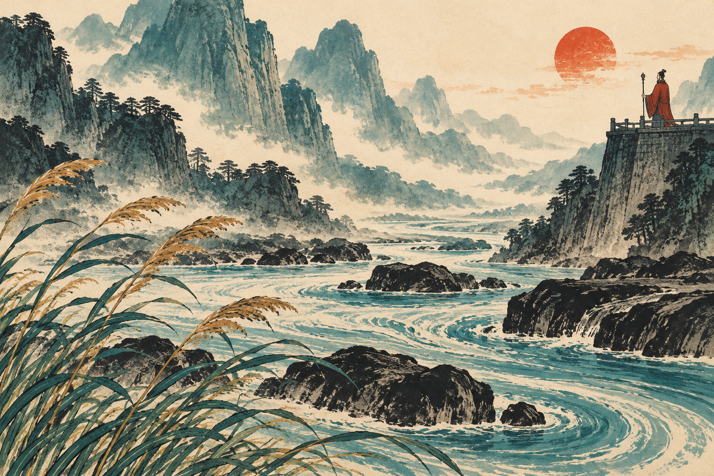
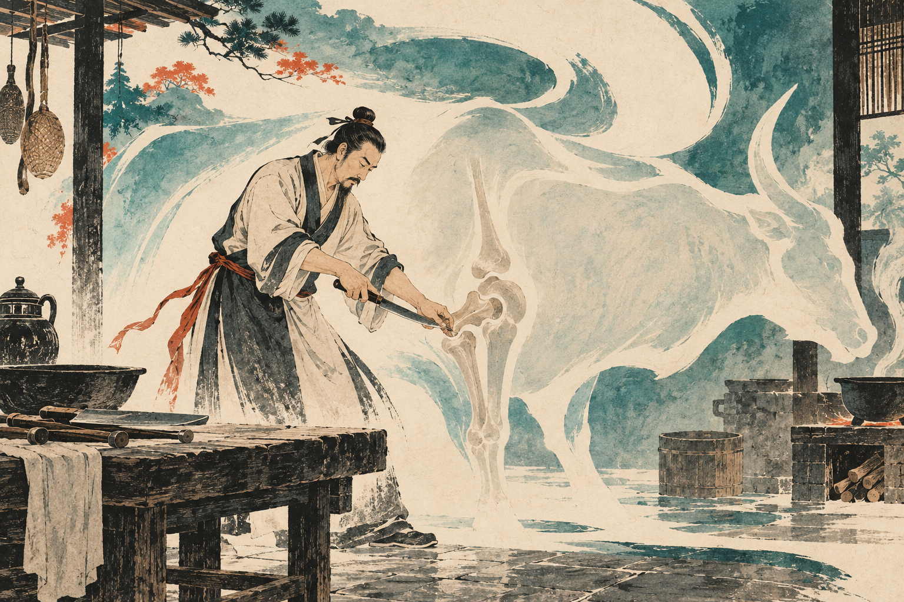
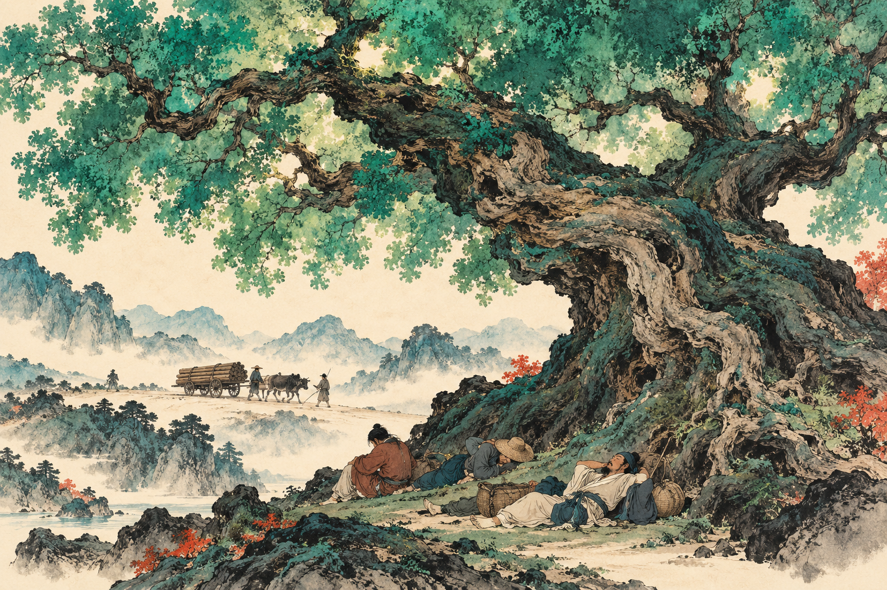

# History of Ethics in China — Part 2: The Job Offer and the Dead Tortoise

The king of Chu wanted Zhuangzi to help run his kingdom. Two officials went to find him. They discovered the philosopher fishing.

In the story preserved in the *Zhuangzi*, he did not immediately put down his rod. Instead, he mentioned a sacred tortoise. It had been dead for three thousand years, and the king kept its remains carefully wrapped and stored in the ancestral temple. Very distinguished. Excellent accommodation. One minor drawback: the tortoise was dead.

Would it have preferred this honor, Zhuangzi asked the officials, or being alive with its tail dragging in the mud? The officials chose the mud. Zhuangzi told them to leave him to his own muddy tail. The king's recruitment effort had suffered an unexpected reptile-related setback. [1]

This is a literary anecdote, not a recorded employment interview. Its target is recognizable nonetheless: a society so certain that office, prestige, and usefulness are good that it forgets to ask what they cost the person receiving them.

*An imaginative rendering of the Zhuangzi's tortoise story; AI-generated illustration.*

## The other way to fix the world

Confucius wanted rulers to perform their roles properly. The texts associated with **Laozi** and **Zhuangzi** are much less confident that adding more instruction, ceremony, and ambitious improvement will solve the problem. Sometimes the enthusiastic person fixing everything is the problem.

They became central to what we call **Daoism**. That label covers diverse philosophical and religious traditions developed over centuries. It does not mean all Daoists agreed, and it should not reduce a living religious tradition to a handful of clever sayings.

Laozi means “Old Master.” Later tradition supplied a life story, including a departure through a western pass, but historians cannot securely reconstruct a single author behind the *Daodejing*, the short book associated with the name. The text took shape in ancient China, and its dating and composition remain debated. Zhuangzi is conventionally placed in the fourth century BCE; the book bearing his name includes material from different hands. Fortunately, a book can be interesting without its author having a reliable passport record. [2, 3]

The central word is **dao**, the Way. Confucians also use it, but the *Daodejing* gives it a broader reach: the source and course of things, exceeding the names and classifications people impose. It is not simply a divine official issuing orders from a larger palace.

The opening warns that the Way captured in language is not the constant Way. That does not make every sentence useless, including the sentence making the warning. It cautions against confusing a description with everything it describes. A map can guide a traveler without containing the mountains. [4]

## Water has not submitted a strategic plan

The *Daodejing* repeatedly admires water. It benefits living things, occupies low places, and moves around obstacles. People competing for the highest position are invited to notice something effective that keeps heading downhill.

This image helps explain **wuwei**, often translated as nonaction. The translation sounds like an excellent excuse to remain in bed. But the idea is not that nobody should ever move. It concerns acting without forcing, overcontrolling, or imposing unnecessary strain. **Ziran**, sometimes translated as naturalness or spontaneity, literally suggests being “so of itself”: allowing things to unfold according to their own character. [2, 4]

An invented modern comparison helps. A nervous teacher interrupts every pause in a student's explanation, corrects each phrase before the thought is finished, and supplies the answer when silence lasts three seconds. The teacher is certainly doing a lot. The student is getting very little practice thinking. Reducing interference would be an active decision about what the situation needs.

The comparison has limits. A child running into traffic needs intervention. A ruler cannot excuse neglect by announcing a commitment to naturalness. The Daoist challenge is to distinguish responsive action from activity performed because the person in charge cannot bear not being in charge.

*Water and softness as recurring images in the Daodejing; AI-generated illustration.*

For government, this becomes a pointed criticism. The *Daodejing* links people's hunger with excessive demands from those above. It treats weapons as dreadful instruments and victory as a reason for mourning rather than swagger. It also compares governing a large state to cooking a small fish. Excessive handling can ruin what the cook means to improve. [4]

None of this makes the text a straightforward modern manifesto for freedom. Some passages favor small, simple communities with limited desires and knowledge. A ruler could use simplicity as a reason to restrain his own ambitions—or as a reason to keep everyone else manageable. The text's suspicion of grand schemes does not automatically settle who gets to decide what counts as excessive.

Its **de**, often translated as virtue or potency, also differs from a public display of moral achievement. The best conduct need not keep announcing how excellent it is. Once generosity requires an audience and a photograph, something besides generosity has entered the arrangement.

## A cook who knows when to slow down

The *Zhuangzi* gives this attention to circumstances a body and a blade. Cook Ding is cutting up an ox before a ruler. His movements are so assured that the work seems rhythmic. Asked how he does it, he explains that years of practice have changed what he perceives. He follows the animal's structure and guides the knife through openings instead of hacking through resistance.

His blade has lasted nineteen years, the story says, through thousands of oxen. That is the sort of claim that would make a knife salesman reconsider inviting him to speak.

But the account contains a crucial detail. When Ding reaches a difficult place, he becomes cautious. He slows down. The celebrated ease includes knowing when ease would be dangerous. Afterward, he cleans the knife and puts it away. [5]

This is a story about skilled responsiveness, not supernatural exemption from anatomy. The cook has trained himself to notice differences that a beginner misses. He can act fluidly because he does not treat every part of the task as identical.

The ethical connection lies in attention and restraint. A person can enter a family argument with a rule prepared in advance and apply it like an axe. Another person may hear the fear beneath the complaint, recognize what would humiliate someone, and find a response that does less damage. This is an analogy, not a claim that human beings should be treated as pieces of meat. The relevant skill is sensitivity to the situation's actual structure.

*A non-graphic interpretation of Cook Ding's skill; AI-generated illustration.*

## The tree that failed to become furniture

Zhuangzi's friend Huizi complains about a huge, crooked tree. Its trunk and branches are unsuitable for a carpenter. He compares it to Zhuangzi's ideas: large, impressive, and useless.

Zhuangzi offers a different arrangement. Let the tree stand in an open place. Wander beside it. Rest in its shade. Being unsuitable for timber is precisely what keeps the axe away. The tree has failed an assessment designed by somebody who wants to cut it down. From the tree's point of view, this is promising news. [6]

The story changes the owner of the word **useful**. Useful to a carpenter means becoming boards. Useful to a tired traveler might mean remaining a tree. Useful to the living tree means something else again. A single standard has been pretending to represent every interest involved.

That move is one of the *Zhuangzi*'s most productive habits: shifting perspective until a confident judgment looks less complete. A court sees a potential official; the fisherman sees the possibility of losing his freedom. The difference does not disappear because the court has better clothes.

This is not the easy assertion that every opinion is equally good. The cook's clumsy apprentice cannot produce the same results merely by having an alternative perspective. Skill, suffering, survival, and the consequences of conduct still matter. The book unsettles rigid certainty while repeatedly showing the value of close attention. [3]

## A dream without a certificate

In another famous passage, Zhuangzi dreams he is a butterfly. While dreaming, he does not worry about being a philosopher. Waking, he wonders about the relation between the two experiences. The text does not hand him an official certificate confirming that his current viewpoint occupies the center of existence. [3]

The story has supported many interpretations. At minimum, it makes the familiar self less secure as the unquestioned judge of everything. People ordinarily move through the world as though their habits of classification are printed on the universe itself. Then a dream, a bereavement, a new skill, or an encounter with a different life shows how much had been supplied by their own position.

Laozi and Zhuangzi do not offer identical teachings. The *Daodejing* often addresses governing and the patterns of the Way; the *Zhuangzi* delights in stories that loosen our grip on fixed identities and ambitions. Together they supply powerful tools: restraint before interference, attention before force, and skepticism when prestige arrives disguised as everyone's obvious goal.

The officials in the tortoise story could appreciate the choice when it belonged to a tortoise. Living freely in the mud was plainly preferable to being an honored set of bones. Zhuangzi simply declined to make an exception for himself.

The tree, meanwhile, remained inconveniently alive. Under its crooked branches there was room to lie down.

*The usefulness of a tree that cannot become timber; AI-generated illustration.*

## Sources

[1] *Zhuangzi*, chapter 17, tortoise anecdote; [David K. Jordan's translation, UC San Diego](https://pages.ucsd.edu/~dkjordan/chin/LaoJuang/MudTortoise-e.html).

[2] [Stanford Encyclopedia of Philosophy: Laozi](https://plato.stanford.edu/entries/laozi/), for authorship and conceptual context.

[3] [Stanford Encyclopedia of Philosophy: Zhuangzi](https://plato.stanford.edu/entries/zhuangzi/); *Zhuangzi*, chapters 2 and 17.

[4] *Daodejing*, especially chapters 1, 8, 17, 30–31, 38, 48, 57, 60, 75, 78 and 80. [James Legge's public-domain translation](https://www.gutenberg.org/cache/epub/216/pg216-images.html). Explanations are original paraphrases.

[5] *Zhuangzi*, chapter 3, [Cook Ding, translated by Edward Tsang](https://www.bracil.net/edward/library/Zhuangzi-cook/index.html).

[6] *Zhuangzi*, chapter 1, tree passage reproduced on [University of Southampton's philosophy teaching site](https://www.southampton.ac.uk/~cpd/pies/Utility.html).
