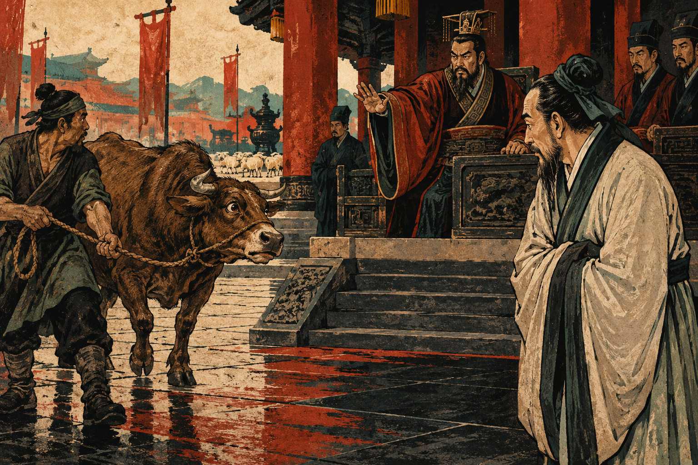
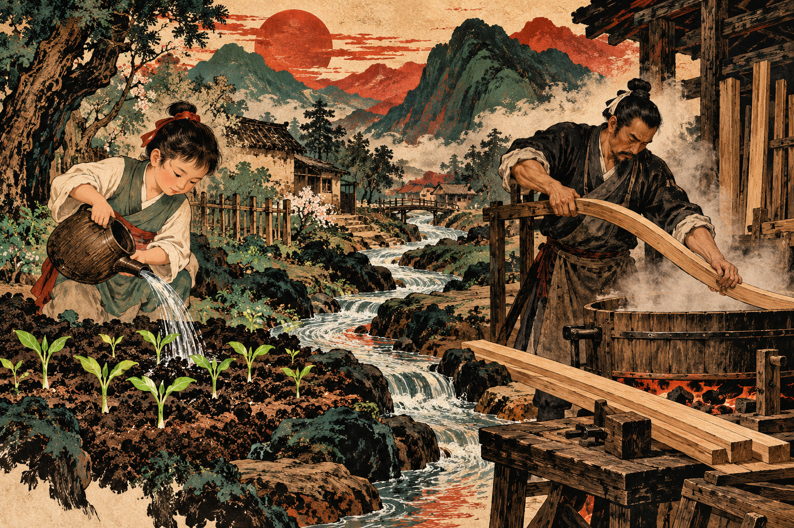
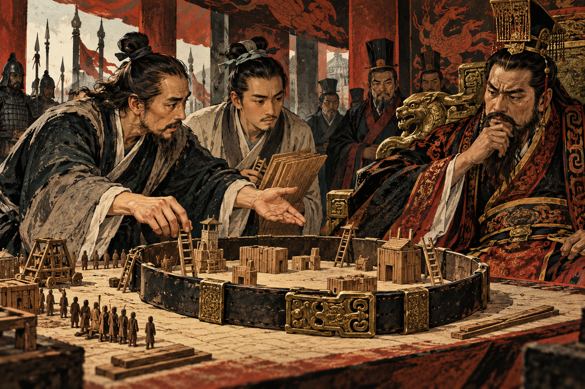
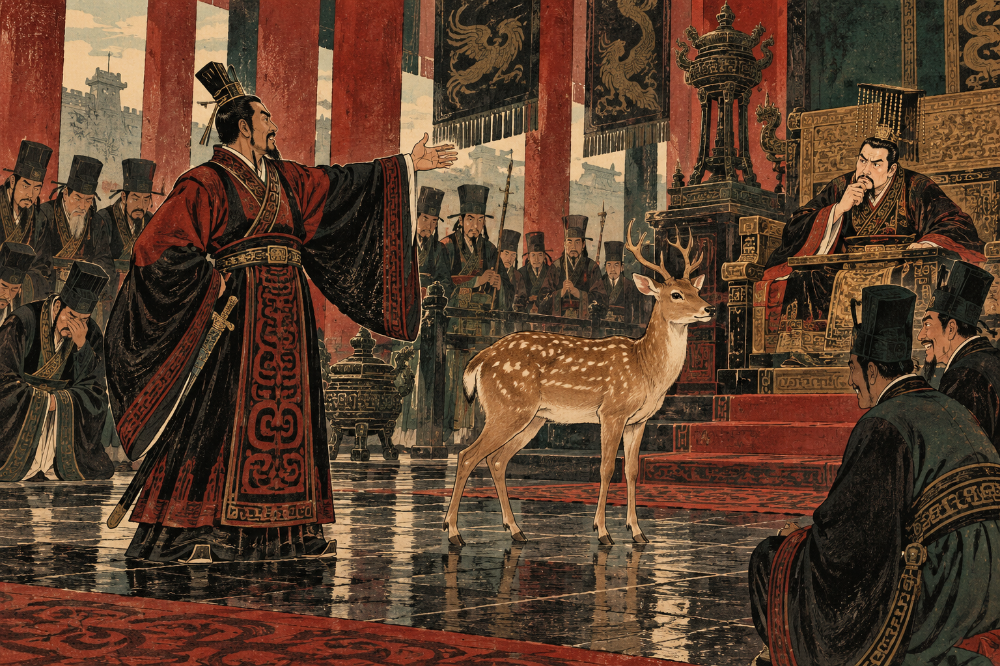

# History of Ethics in China — Part 3: The King, the Ox, and the Extremely Convenient Horse

The ox was on its way to be sacrificed when the king noticed it trembling.

King Xuan of Qi could not bear the sight. He ordered it spared. Asked whether the ceremony should therefore be canceled, he said a sheep could be used instead.

Excellent news for the ox. A more mixed announcement for the sheep.

The philosopher Mencius heard about this and did something more interesting than calling the king a hypocrite. He treated the moment of compassion as a beginning. The king had seen the ox's fear. He had not seen the sheep. His concern was real, but it had a very limited field of vision. The task was to extend it. This exchange appears in the *Mengzi*, the book associated with Mencius. It is an ancient philosophical account, not a transcript we can independently verify. [1]

The people living under a king's government could also suffer without being brought through his courtyard. A ruler might be moved by one frightened animal while failing to respond to thousands of distant households. Mencius's strategy was to connect the capacity already present with the responsibilities being neglected.

*The ox episode in the Mengzi, imagined rather than reconstructed; AI-generated illustration.*

## Four small beginnings

Mencius, or Mengzi, lived in the fourth century BCE and developed the Confucian tradition after Confucius's death. He argued that human nature contains beginnings of goodness. That is not the claim that every toddler arrives ready to administer a just government.

His famous example is a child about to fall into a well. A witness suddenly feels alarm and concern, before calculating applause, payment, or friendship with the parents. The point is the spontaneous response. Mencius uses this imagined case as evidence that concern for others is not merely a costume put on to obtain rewards. [1]

He describes **four sprouts**: compassion, which can grow into **ren**, humaneness; shame at wrongdoing, which can grow into **yi**, rightness; respect or deference, which supports **li**, proper conduct; and a sense of approval and disapproval, which develops into **zhi**, moral wisdom.

Sprouts are a carefully chosen image. A shoot is genuinely alive, but it is not a mature tree. Moral capacities need nourishment and practice. They can be neglected, damaged, or cultivated badly.

In another *Mengzi* story, a farmer wants his plants to grow faster. He pulls them upward. After a hard day's helping, he returns home pleased with himself. The plants wither. He has confused visible movement with growth. The story makes impatient moral improvement look approximately as sensible as gardening with pliers. [1]

Mencius also takes material conditions seriously. People struggling to survive cannot simply be scolded into stability. A ruler who leaves families without dependable livelihoods and then punishes their desperate conduct is helping create the behavior he condemns. Moral government therefore includes food, work, and security, not just speeches about virtue.

His account of authority is demanding. A ruler's status does not excuse the destruction of humane government. In a striking passage about the overthrow of a tyrant, Mencius distinguishes killing a true ruler from removing a man who has forfeited the moral substance of that role. This is not modern electoral democracy. It is nevertheless bad news for anyone hoping that a royal title settles every objection. [1]

## Xunzi would like to inspect the sprouts

Another Confucian thinker, **Xunzi**, was less impressed by the idea that goodness grows directly from our original nature. Left unchecked, people want advantage, comfort, and satisfaction; their desires collide. Good conduct requires deliberate effort, education, teachers, and institutions.

His claim that human nature is bad can sound as though he believes infants are tiny criminals awaiting suitable opportunities. More carefully, he argues that our untrained tendencies do not themselves produce orderly, ethical life. Goodness is an accomplishment of conscious activity. People can learn it. The ordinary person has the capacity to become much better. [2]

The difference matters. Mencius emphasizes nurturing moral beginnings. Xunzi emphasizes shaping conduct through practices people have developed. They agree about the importance of education and self-cultivation while disagreeing about what education works upon.

A modern comparison would be a school that wants students to collaborate. Encouragement alone may not solve unequal work, vague responsibilities, and rewards given only to the loudest speaker. Clear roles and repeated practice can help. But if the system teaches students that nothing matters except avoiding penalties, it may train excellent rule-dodgers. These are our examples, not ancient classroom reports. They show why debates about nature lead quickly into debates about institutional design.

*Two metaphors for cultivation, not portraits of a single school; AI-generated illustration.*

## Mozi brings the people outside the family

While Confucian thinkers argued over cultivation, the **Mohists**, followers of Mozi, pressed a different problem: people care intensely about their own households and states, then injure other households and states for their benefit.

Their answer was **jian ai**, inclusive or impartial care. **Impartial** here means that another person's welfare does not stop counting because that person belongs to a different family. It need not mean feeling exactly the same affection for a stranger as for a parent. It challenges the assumption that strangers may be sacrificed whenever one's own group gains. [3]

This creates a useful disagreement with the emphasis on special relationships. A parent has responsibilities toward a child that do not apply in exactly the same way to every other child. But an official distributing emergency food cannot simply send the supplies to cousins. The relationship has changed, so the appropriate conduct changes too. These are modern examples of the competing demands, not cases from the Mohist texts. They show why neither affection nor impartiality can be treated as a decorative word. Each can alter who receives food, protection, or an opportunity to be heard.

For a government, expanding the circle of concern can be costly. People beyond the circle may have been supplying cheap labor, convenient enemies, or territory worth taking. Calling them equally worthy of consideration interferes with a plan already in progress. That helps explain why a doctrine of care could become an argument about armies.

The Mohists judged policies by benefits and harms: whether they supported people's livelihood, order, and well-being. Their attention to consequences resembles later **consequentialist** reasoning, though their religious commitments, standards, and political program were their own. It would be misleading to turn them into modern utilitarians wearing ancient clothes.

Their opposition to aggressive warfare was practical. In the story of Mozi and Gongshu Ban, an engineer has built siege equipment for Chu to attack Song. Mozi travels to stop it. He first exposes the inconsistency of an engineer who refuses to murder one person but helps organize an invasion. Then he argues with the king. Moral persuasion does not finish the job.

So he models Song's defenses with a belt and wooden pieces, defeating the engineer's proposed attacks. When killing Mozi becomes the implied solution, he reveals that his followers are already in Song, prepared to defend it. The king abandons the attack. In the story, compassion has arrived with technical preparation and a backup plan. [4]

*The miniature siege from the Mozi; AI-generated illustration.*

Mohism was no simple celebration of independent choice. Its proposals also included strong hierarchy and bringing people's judgments into agreement with virtuous superiors. A movement could oppose invasion and still trust centralized authority more than many modern readers would. The awkward combinations are part of the history.

## Han Fei does not intend to wait for excellent people

The thinkers grouped under **Legalism**, or *fajia*, were not one perfectly unified school. The label is later, and “legalism” can mislead if it suggests modern constitutional limits on government. Their concern was effective rule, with **fa**—standards, methods, and laws—playing a central role.

**Han Fei**, who died in 233 BCE, distrusted dependence on a ruler's personal moral excellence or a minister's promises. Governments needed ways to compare claims with performance and make conduct answerable to consequences. Rewards and punishments were the ruler's **two handles**, or levers. Handing those levers to ministers invited those ministers to become the people everyone actually obeyed. [5]

There is a recognizable insight here. An organization cannot run entirely on assurances that everybody means well. Clear standards and accountability can restrain favoritism. But an apparatus designed to strengthen the ruler can also become extraordinarily efficient at carrying out his cruelty. Predictable punishment is not automatically just punishment.

The Qin unified the rival states in 221 BCE, drawing on a powerful administrative and military system. The dynasty then collapsed within a generation. Its achievements and violence became material for later arguments about government. A cautionary story from its final years gives the two handles a particularly unpleasant demonstration.

## The deer has entered politics

According to Sima Qian's *Shiji*, the chief minister **Zhao Gao** brought a deer before the Second Emperor and called it a horse. The emperor laughed and challenged the description. Then the officials were asked for their responses.

Some remained silent. Some agreed it was a horse. Others said it was a deer. Zhao Gao subsequently used legal accusations against those who had correctly identified the animal. The remaining officials became afraid of him. [6]

This was an unusually efficient assessment. No specialist knowledge was required. The lie was obvious, which meant agreement communicated something more useful than a mistake: willingness to cooperate despite knowing better.

The emperor himself had recognized the deer. His correct answer did not protect the officials who agreed with him. Zhao Gao could threaten them through the law, and that practical authority mattered more than the seating arrangement at court.

Han Fei would have recognized the danger of a minister controlling punishment. Confucius would have had plenty to say about names and conduct. Mozi could have counted the harm, while Mencius might have looked for the human concern being pushed aside.

The officials did not need a more detailed lesson in zoology. They needed a way to tell the truth without putting themselves at the mercy of the man asking the question.

The deer stood there throughout, doing nothing to justify its promotion.

*Zhao Gao's loyalty test as narrated in the Shiji; AI-generated illustration.*

## Sources

[1] *Mengzi*, especially 1A7, 1B8, 2A2 and 2A6; [Stanford Encyclopedia of Philosophy: Mencius](https://plato.stanford.edu/entries/mencius/); [James Legge's public-domain translation of Mencius](https://original.sacred-texts.com/cfu/menc/index.htm).

[2] [Stanford Encyclopedia of Philosophy: Xunzi](https://plato.stanford.edu/entries/xunzi/), especially human nature and deliberate activity.

[3] [Stanford Encyclopedia of Philosophy: Mohism](https://plato.stanford.edu/entries/mohism/); [OpenStax: Classical Chinese Philosophy](https://openstax.org/books/introduction-philosophy/pages/3-3-classical-chinese-philosophy).

[4] *Mozi*, chapter 50, “Gongshu”; translation in [academic proceedings](https://nuaca.am/wp-content/themes/nuaca/images/Proceedings.pdf), and analysis in [Duheng's dissertation](https://sinologymethods.com/wp-content/uploads/2022/01/Duheng-2018-aug-diss-authors-two-bodies.pdf), pp. 379–380.

[5] [Stanford Encyclopedia of Philosophy: Legalism in Chinese Philosophy](https://plato.stanford.edu/entries/chinese-legalism/); [Han Fei, “The Two Handles,” translated excerpt](https://history.hanover.edu/courses/excerpts/261han.html).

[6] *Shiji*, chapter 6, translated and discussed in [“Writing as Control, Writing as Morality”](https://jospl.org/upload/pdf/jspl-2025-019.pdf), p. 72. The deer episode is presented as an ancient historical narrative, not independently verified dialogue.
