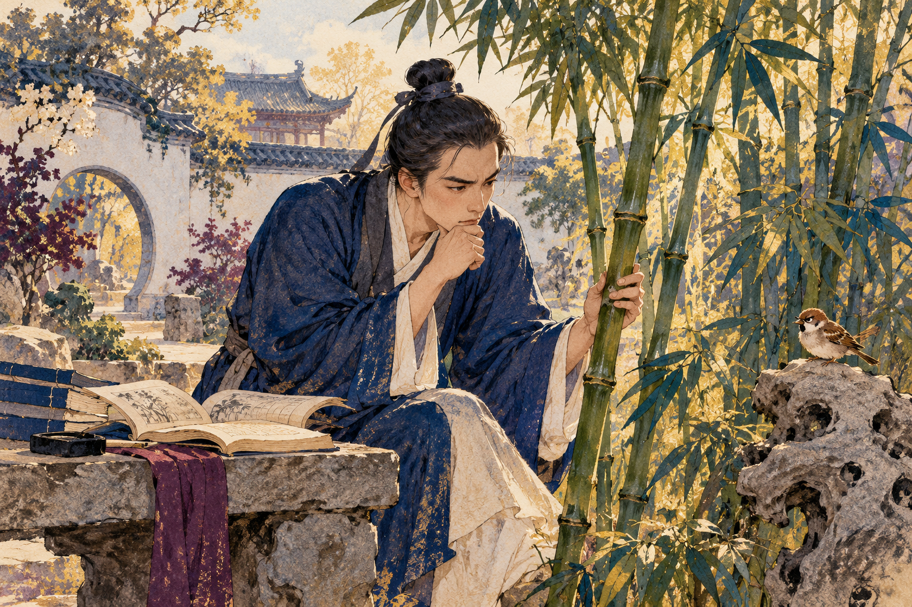
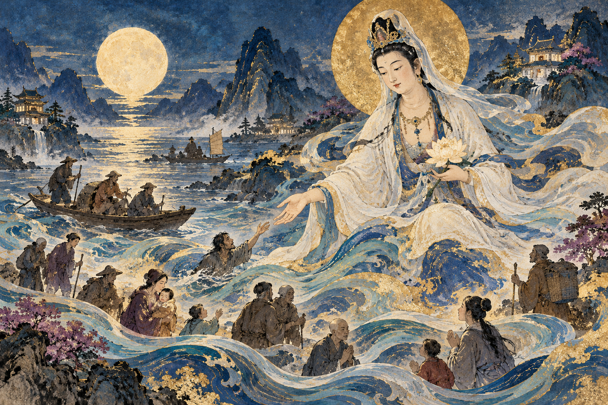
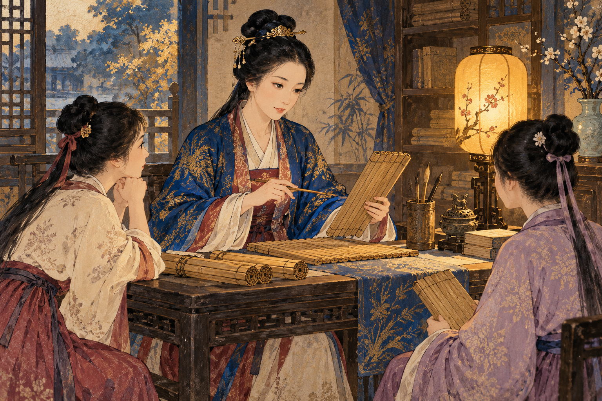
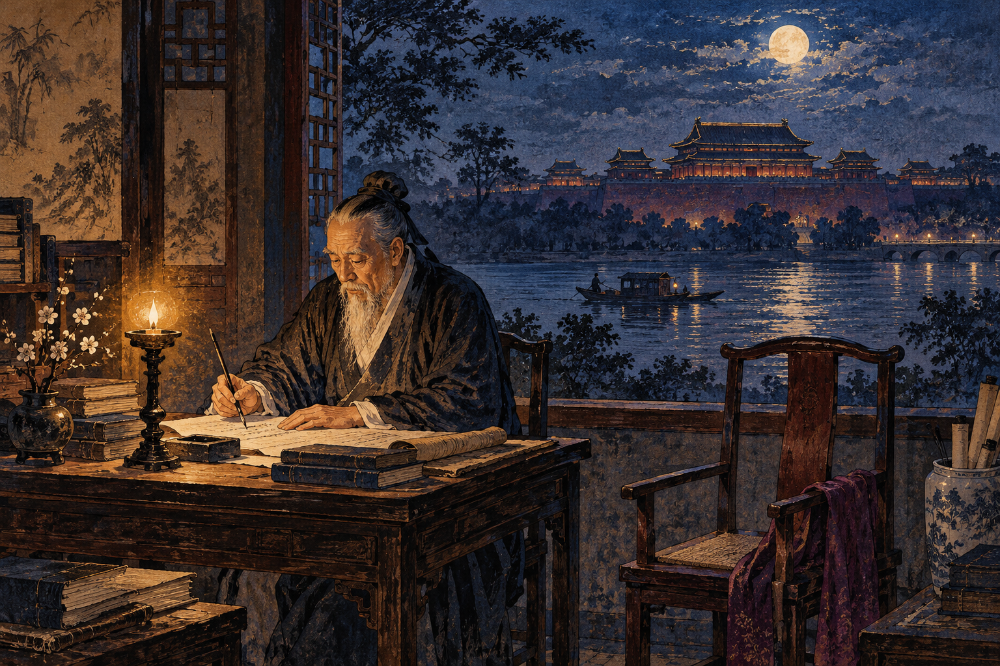

# History of Ethics in China — Part 4: The Bamboo Would Not Explain Itself

Wang Yangming and a friend decided to become sages by investigating bamboo.

They had encountered the idea that understanding the principles of things was essential to becoming wise. There was bamboo nearby. It seemed a manageable place to begin. According to Wang's later recollection, his friend concentrated on it until he became ill. Wang tried too, persisted longer, and also became ill. The bamboo made no recorded concession.

This was not quite what the earlier philosopher Zhu Xi had meant by investigating things. But the failed experiment became part of Wang's account of his search for a better way to understand moral learning. Being able to repeat an impressive instruction was apparently different from knowing what to do with it. [1]

Wang lived from 1472 to 1529, almost two thousand years after Confucius. Between them lay empires, invasions, religious transformations, and arguments over what the old teachings actually meant. Chinese ethical thought had not spent those centuries sitting politely in its original position.

*Wang Yangming's remembered bamboo experiment, imaginatively rendered; AI-generated illustration.*

## Compassion crosses a border

One enormous change was the arrival of **Buddhism**, which originated in South Asia and spread into China through travelers, translators, merchants, and religious communities during the early centuries of the Common Era. It was not a Chinese invention. Chinese Buddhists nevertheless developed influential traditions of their own, including Chan, Tiantai, and Huayan. Ideas crossed borders and changed as people translated, argued, and practiced them. [2]

Buddhist ethics begins with suffering and the patterns that keep producing it. **Dukkha** is often translated as suffering, but includes the dissatisfaction and instability of lives organized around things that cannot remain as we want them. Bodies change. Praise fades. People die. Winning a competition does not prevent another competitor from appearing on Monday.

The **Four Noble Truths** describe suffering, its origins in craving and related ignorance, the possibility of its cessation, and a path of practice. The **Eightfold Path** includes understanding, intention, speech, action, livelihood, effort, mindfulness, and concentration. Ethical conduct is woven into the practice; it is not a permission slip issued after meditation has made someone interesting. [3]

**Karma** concerns morally significant action and its consequences, with intention playing a central role. It is not a safe shortcut for declaring that anyone suffering must deserve it. Buddhist traditions discuss many causes and conditions, and compassion requires responding to suffering rather than congratulating oneself on having found an explanation.

**Impermanence** means that things arise and change. **Non-self** challenges the idea of a permanent, independent inner owner standing apart from all those changes. Neither idea means that pain is imaginary or that people do not matter. They unsettle the habits of possession and attachment through which people make suffering worse. [3]

Consider an ordinary invented example: someone hears criticism, feels shame, and immediately attacks the speaker. The whole sequence can happen before the original criticism has been understood. Attention to the sequence creates a little space in it. The feeling is present; obeying it is not the only possible next action.

That is one practical contribution of this tradition: observing how a harmful response is assembled, instead of treating it as a command from an unchangeable self.

## A thousand hands would still have work to do

The **bodhisattva** ideal in Mahayana Buddhism joins the pursuit of awakening with compassion for other beings. In China, **Guanyin**, associated with the Indian bodhisattva Avalokiteshvara, became an especially beloved embodiment of compassion. Images developed in varied forms, including female forms, and some show many arms and eyes: a visual language of seeing suffering and responding to it. [4]

A reader does not need to share the religious beliefs to understand the moral ambition. Concern must reach beyond the people who are convenient to notice. The person in pain is not required to become useful, admirable, or familiar before compassion begins.

The challenge is what this looks like in ordinary relationships. Confucian critics worried that leaving family life for religious practice could neglect obligations to parents and ancestors. Buddhists developed responses, including accounts of how religious practice could benefit families. The disagreement was real; so was the exchange of ideas. Chinese intellectual history contains sustained argument across traditions, not three sealed boxes labeled Confucianism, Daoism, and Buddhism.

*An original image drawing on Chinese Buddhist visual traditions; AI-generated illustration.*

## The examination system meets moral improvement

From the Song period onward, thinkers often called **Neo-Confucians** developed new accounts of the world and moral cultivation in conversation and conflict with Buddhist and Daoist ideas. **Zhu Xi** (1130–1200) became especially influential. His interpretations of the Confucian classics later shaped education and civil service examinations.

He described **li**, pattern or principle, and **qi**, the material or vital stuff through which things take form. This *li* is a different Chinese word from *li* meaning ritual propriety. English spelling has kindly made an already demanding subject slightly more confusing.

For Zhu Xi, learning involved investigating things and affairs, studying, and working on one's conduct. It was not adequately represented by staring at a plant until a headache arrived. Nor was knowledge supposed to remain detached from action. [5]

Yet an educational system can turn a rich moral tradition into an extremely competitive way of getting a job. When mastering the accepted interpretation brings position and prestige, students have a reason to become skilled at the accepted interpretation. Whether they become kinder people is a separate matter. This is a problem in the incentives, not proof that every successful candidate was a fraud.

Wang Yangming's **unity of knowing and acting**, or **zhixing heyi**, challenged the comfortable gap between saying one knows the good and actually doing it. He was not merely advising people to apply knowledge after acquiring it. He argued that genuine moral knowing already involves action; a person who consistently fails to act has not fully achieved that knowing. [6]

An invented example makes the distinction concrete. Someone can describe every reason humiliating a weaker classmate is wrong, then join in because friends are watching. The fluent explanation has not yet become reliable moral understanding. Wang's argument presses on that failure rather than giving the speaker full credit for the explanation.

His **liangzhi**, innate moral knowing, is the capacity for moral discernment that selfish desires can obscure. Cultivation works to make that capacity effective. It is not a license to treat every confident impulse as wisdom. Otherwise, the loudest person's first reaction would become a philosophy department. [6]

## The women were not absent

Long before Wang, **Ban Zhao**, a scholar of the Eastern Han period, had written about women's conduct and education. She also contributed to the history begun by her family. Her life makes it impossible to say that women were simply incapable of scholarship, though institutions often restricted their access to it. [7]

Her *Lessons for Women* is uncomfortable reading today. It instructs women in humility and obedience within an unequal household order. Yet it also criticizes educating boys while neglecting girls. If proper relationships require both partners to understand their responsibilities, leaving one partner uneducated is a strange method of preparation.

Ban Zhao did not offer a modern program of equal rights. Neither was she merely a silent object of rules made elsewhere. She used the language and expectations available to her to argue about how women should be taught. Later readers have disagreed over whether to emphasize the restrictions she reinforced or the opportunities she claimed. Both are present. [7, 8]

The larger lesson for telling this history is factual: the people whose writings survive and the people who lived ethical lives are not identical groups. Mothers, servants, farmers, nuns, craftspeople, and countless others made decisions whose arguments were never copied into famous books. A history of influential voices is necessarily smaller than the history of moral experience.

*An imagined scholarly scene honoring Ban Zhao's authorship and teaching; AI-generated illustration.*

## The emperor has mistaken the country for his possessions

**Huang Zongxi** (1610–1695) knew that political failure could enter a household and not leave everyone alive. His father died in prison after opposing the powerful court figure Wei Zhongxian. Huang later lived through the collapse of the Ming and the establishment of Qing rule. [9]

In *Waiting for the Dawn*, completed in 1663, he attacked rulers who treated the realm as private property to be handed to their descendants. The benefits flowed toward one household; the suffering was distributed much more generously.

Huang reversed the arrangement. In his account of proper government, the realm's people and interests are primary; the ruler is there to serve them. The famous language of master and guest makes a monarchy sound much less like permanent ownership. A guest who claims the furniture, empties the pantry, and leaves the occupants hungry has misunderstood the invitation. [10]

He also gave schools a political role. They should be places where public affairs and standards of right and wrong could be discussed, rather than institutions whose only task was to repeat the ruler's judgment. Ministers owed service to the wider realm, not merely personal loyalty to the man occupying the throne.

These proposals did not amount to modern universal democracy. Huang still worked within a world of learned elites and monarchy. Their force comes from the specific protections they sought: criticism that could exist outside the ruler's immediate approval, and responsibilities that could not be reduced to his wishes. [10]

Across these four readings, the argument has kept changing location. It has appeared beside a grave, at a riverbank, in front of a frightened ox, and around a deer that nobody was allowed to identify safely. Here it reaches the scholar's desk after a father's death and a dynasty's collapse.

Huang could not bring his father home. What he could do was describe a government in which the ruler did not own everyone else's judgment. His book preserved that demand for people who would live after him, under rulers he would never meet.

*A symbolic portrait of scholarship and dissent; AI-generated illustration.*

## Sources

[1] Wang Yangming's retrospective bamboo account and its context: [Stanford Encyclopedia of Philosophy: Wang Yangming](https://plato.stanford.edu/entries/wang-yangming/).

[2] [Stanford Encyclopedia of Philosophy: Chinese Ethics](https://plato.stanford.edu/entries/ethics-chinese/), section on Chinese Buddhist ethics.

[3] [Stanford Encyclopedia of Philosophy: Ethics in Indian Buddhism](https://plato.stanford.edu/entries/ethics-indian-buddhism/), for the inherited Buddhist ethical framework; these ideas originated outside China and developed further within Chinese traditions.

[4] [Asian Art Museum: The bodhisattva Avalokiteshvara (Guanyin)](https://collections.asianart.org/collection/guanyin/); [Penn Museum: Guanyin](https://www.penn.museum/collections/object/179391).

[5] [Stanford Encyclopedia of Philosophy: Zhu Xi](https://plato.stanford.edu/entries/zhu-xi/).

[6] [Internet Encyclopedia of Philosophy: Wang Yangming](https://iep.utm.edu/wangyang/).

[7] [Ban Zhao, Lessons for Women, translated selection hosted by Columbia University](https://www.columbia.edu/itc/ealac/moerman/fall2000/edit/pdfs/wk2/banzha1.pdf).

[8] Ann A. Pang-White, [“Reappraising Ban Zhao”](https://www.cambridge.org/core/books/abs/ancient-women-philosophers/reappraising-ban-zhao/CB84B98EA5ED8E2769742CF4C5C4537E).

[9] Biographical context in [The Origin of Law, Huang Zongxi section](https://english.court.gov.cn/pdf/TheOriginofLaw.pdf).

[10] Huang Zongxi, *Mingyi daifang lu* (*Waiting for the Dawn*), especially “On the Ruler,” “On Ministers,” and “Schools”; [original Chinese text](https://www.gutenberg.org/cache/epub/23855/pg23855-images.html). The discussion above paraphrases the arguments rather than reproducing a modern translation.
