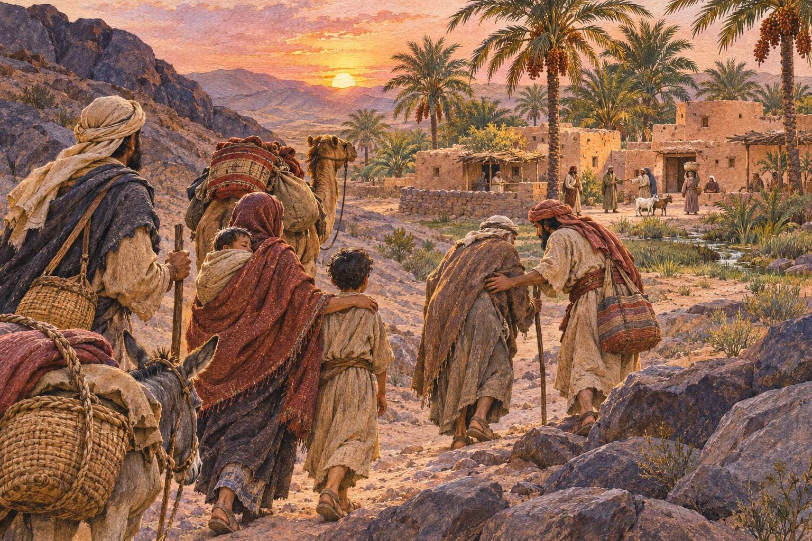
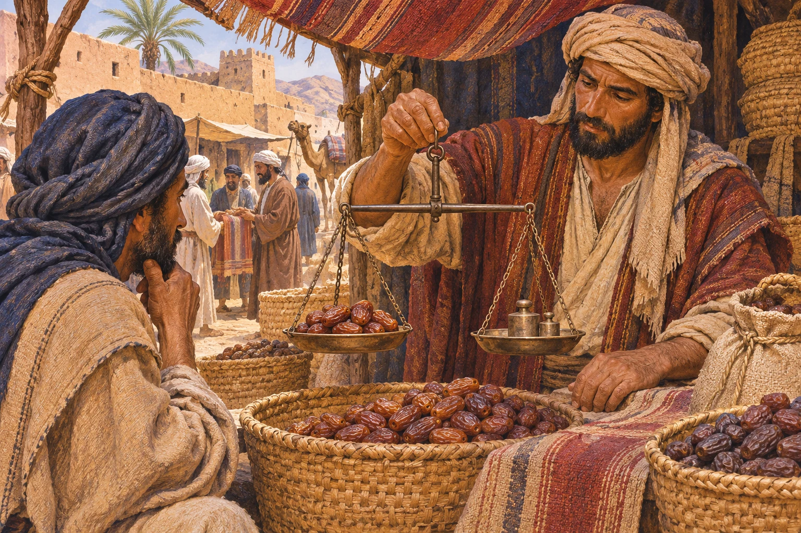
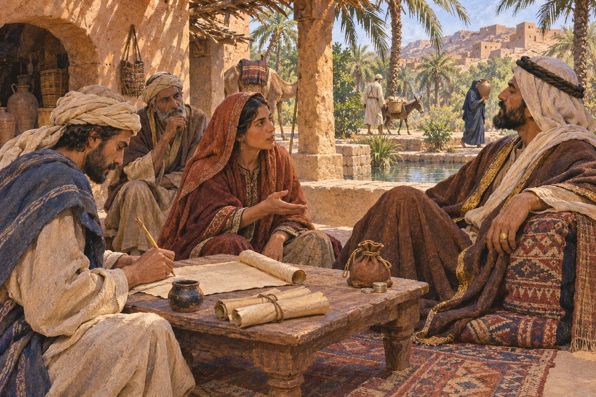
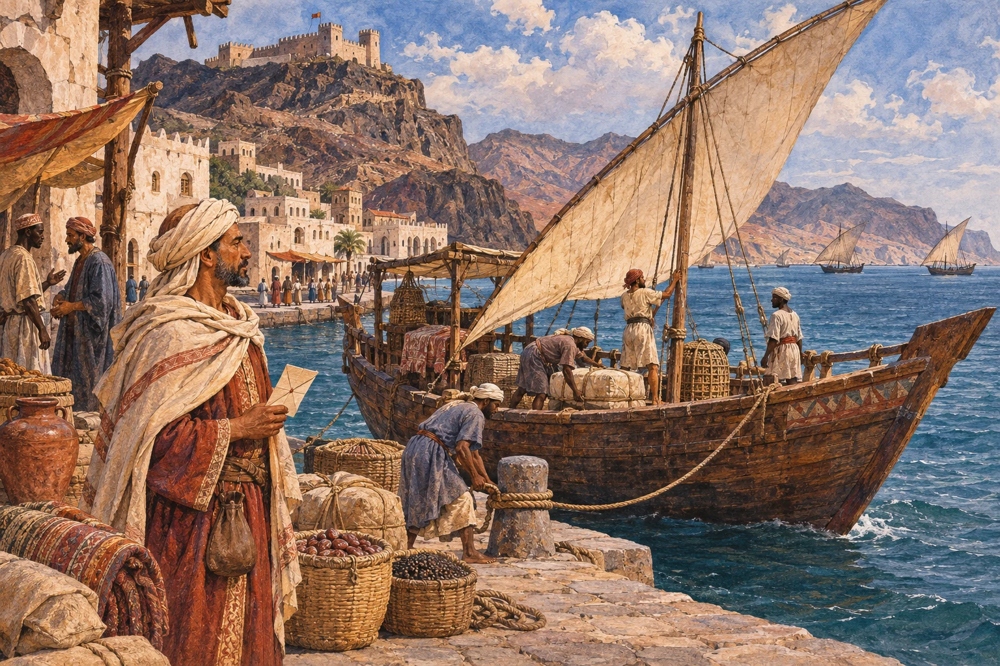

# What Do We Owe Each Other?

## A community that has to begin again

In 622, Muhammad and his followers leave Mecca for the oasis settlement of Medina. They are not moving because they have found better houses. Opposition to their religious movement has made remaining in Mecca dangerous. Migration means leaving familiar protection behind. A community that has preached a different way of living must now work out how to live together. Belief has become a problem of shelter, food, agreements, and authority. [[1]](https://www.metmuseum.org/essays/the-birth-of-islam)

Muhammad was born in western Arabia around 570. According to Muslim belief, he began receiving revelations from God around 610; these became the Qur’an. He proclaimed one God, called Allah in Arabic, and accountability beyond death. Muslims understand him as a human prophet, not a god, and as the last in a line that includes Abraham, Moses, and Jesus. Islam therefore arose in conversation and conflict with existing religious traditions, including Judaism and Christianity. [[1]](https://www.metmuseum.org/essays/the-birth-of-islam)

Mecca was a trading and pilgrimage centre. Muhammad’s message challenged the worship of multiple deities, but it also challenged the idea that prosperity proved someone deserved their position. The Qur’an repeatedly directs attention toward people who lack protection: orphans, the poor, and people dependent on others. A powerful household could keep its members fed. The harder test was the person standing outside its door. [[2]](https://openstax.org/books/world-history-volume-1/pages/11-1-the-rise-and-message-of-islam)

*Migration required shelter, protection, and new relationships. Imagined early Arabian setting; AI-generated illustration, not a depiction of Muhammad.*

The migration, or *hijra*, became the starting point of the Islamic calendar. In Medina, Muhammad became a political leader as well as a religious teacher. Agreements, warfare, alliances, and worship all helped shape the emerging community, the *umma*. This was no peaceful laboratory insulated from history. Building a community required decisions about competing loyalties and the use of force. By Muhammad’s death in 632, the movement had transformed Arabia’s political landscape. [[3]](https://www.metmuseum.org/it/learn/educators/curriculum-resources/art-of-the-islamic-world/unit-one/the-prophet-muhammad-and-the-origins-of-islam)

Five practices often introduce students to Islam: declaring faith, praying, giving obligatory alms, fasting during Ramadan, and making the pilgrimage to Mecca when able. These are commonly called the Five Pillars. Their details vary across Muslim traditions. They connect belief with repeated actions: interrupting work for prayer, restraining appetite, sharing wealth, and travelling among other believers. Religion is something a person practises with time, body, and possessions. [[4]](https://www.metmuseum.org/es/learn/educators/curriculum-resources/art-of-the-islamic-world/unit-one/the-five-pillars-of-islam)

Political authority also became deeply contested. After Muhammad’s death, disputes over leadership helped produce the traditions later known as Sunni and Shi‘a Islam. Shi‘a traditions gave special authority to Ali, Muhammad’s cousin and son-in-law, and to leaders from the Prophet’s family. Sunni traditions developed different accounts of legitimate leadership and religious authority. Both grew internally diverse; their disagreements were more than a permanent quarrel between two fixed teams. [[13]](https://openstax.org/books/world-history-volume-1/pages/11-3-islamization-and-religious-rule-under-islam)

Military conquests after 632 brought large territories under Muslim rule, including lands previously governed by the Byzantine and Persian empires. Political conquest and religious conversion were different processes: populations did not all become Muslim when an army arrived. The resulting societies contained unequal legal statuses and continued slavery. Ideals of justice existed within these hierarchies, furnishing grounds for criticism without automatically removing the inequalities. [[13]](https://openstax.org/books/world-history-volume-1/pages/11-3-islamization-and-religious-rule-under-islam)

In 680, Muhammad’s grandson Husayn was killed at Karbala by forces serving the Umayyad ruler Yazid. His death became central to Shi‘a remembrance and a powerful image of resistance to unjust authority. The moral problem was immediate: a government could rule over Muslims without thereby making its actions just. Religious language could support rulers, but it could also furnish a standard against which rulers were condemned. [[14]](https://www.iranicaonline.org/articles/karbala/)

## The creditor also has obligations

The pillar concerned directly with wealth is *zakat*, obligatory giving by those who meet its conditions. It differs from a generous impulse that may or may not arrive. Qur’an 9:60 identifies categories of recipients, including poor people and people burdened by debt. Wealth therefore carries claims upon it. Ownership does not make every decision about money morally private. [[5]](https://quran.com/en/at-tawbah/60)

Debt makes this especially difficult. A loan can rescue a household after a failed harvest. It can also give a lender increasing power over that household. The same agreement may begin as assistance and become a trap. Calling it a contract does not settle whether its terms, or the way they are enforced, are fair.

Consider an invented example. A date grower borrows ten baskets of grain to feed a family until harvest. The crop fails. If the lender demands twelve baskets next season, then fifteen, the household’s effort may go toward catching a total that keeps moving away. The lender can point to an agreement. The borrower can point to children who still need food. Both facts belong in the account.

*Trade makes fair measurement an everyday ethical practice. Imagined scene; AI-generated illustration.*

The Qur’an distinguishes lawful trade from *riba*, a prohibited increase associated with lending and certain exchanges. It also instructs creditors to allow time to debtors in hardship and commends forgiving the debt. In a nearby passage, it calls for debts with a fixed term to be recorded. These passages preserve agreements while placing limits on what creditors may demand. [[6]](https://quran.com/en/al-baqarah/275-282)

That combination matters. A religious tradition can defend promises and still refuse to treat repayment as the only obligation. The borrower’s duty does not erase the lender’s duty. Written terms can prevent later manipulation; relief can prevent an honest agreement from becoming destructive when circumstances change. Protecting a transaction and protecting a person are related tasks, but they are not identical.

Later Muslim jurists developed detailed rules governing commerce. Many identified interest on loans with prohibited riba; modern scholars continue to dispute particular applications. *Sharia* refers broadly to the divinely guided way of life. *Fiqh* is human jurisprudence: the work of interpreting sources and deciding practical rules. Confusing the two makes every scholar’s decision sound as though it arrived directly from heaven. Different schools could share sacred sources while disagreeing about a contract. [[7]](https://www.europarl.europa.eu/thinktank/en/document/EPRS_ATA%282015%29557008)

## What Graeber notices

The anthropologist David Graeber, author of *Debt: The First 5,000 Years*, asked why paying debts so often appears to be the foundation of being a good person. His argument was not simply that promises are worthless. He argued that obligations become dangerous when a precise amount is treated as more important than the relationships and circumstances that produced it. He also challenged the familiar story in which barter naturally becomes money and only later becomes credit. [[8]](https://davidgraeber.org/articles/to-have-is-to-owe/)

In everyday life, these categories are easier to separate than they first appear. Someone who helps a neighbour carry water may expect help another day without calculating an exact exchange. A shopkeeper who supplies food on credit does need an account. Neither arrangement is automatically bad. Trouble begins when every kind of human dependence is imagined as a bill, or when the existence of a bill supposedly ends moral argument.

*Recording a debt can protect the parties without settling every moral question. Imagined scene; AI-generated illustration.*

Graeber found medieval Islamic commerce particularly interesting because restrictions on interest existed alongside extensive trade and credit. He argued that moral expectations, reputation, and networks of trust helped merchants do business across large distances. This is Graeber’s interpretation of the evidence, not a claim that every Muslim merchant was trustworthy or that courts and governments were unnecessary. It offers a different possibility: rules limiting exploitation might help markets function. [[9]](https://davidgraeber.org/articles/debt-violence-and-impersona-markets-polanyian-meditations/)

Imagine two ways of funding a voyage. In one, a lender demands a fixed return even if the cargo is lost. In another, an investor supplies capital and a merchant supplies work, with profit divided by agreement and ordinary financial loss falling on the investor. These are simplified illustrations, not accounts of a particular voyage. They show why sharing commercial risk differs from merely renaming interest. Islamic law developed partnership arrangements with precisely such distinctions, including rules about negligence. [[10]](https://www.iadi.org/uploads/Insurability_of_Islamic_Deposit_Investment_Accounts_publication-Nov_2014-FINAL.pdf)

Removing interest does not remove uncertainty. A merchant may lie, a ship may sink, or a partner may keep poor records. Trust therefore involves more than warm feelings. It needs ways to establish what happened, whose responsibility it was, and whether an apparent misfortune concealed misconduct. Religious ethics enters the ordinary business of evidence.

## The letter that crossed the sea

At the end of 1103, a Jewish merchant from North Africa waited to sail toward India and wrote to a relative in Tripoli. His letter survives among the Cairo Geniza documents, a vast collection preserved through a synagogue in old Cairo. We do not know his name or final fate. We do know that he described stages of a difficult journey and asked for prayers. A trading network that looks smooth on a map was, for its participants, delays, dependence, and uncertain news. [[11]](https://www.lib.cam.ac.uk/collections/departments/taylor-schechter-genizah-research-unit/fragment-month/fotm-2026/fragment-1)

His presence matters. Commerce in societies governed by Muslim rulers was not conducted exclusively by Muslims. Jewish and Christian communities also maintained commercial, legal, and intellectual networks. These relationships could cross religious boundaries without erasing them. Cooperation in a port did not mean equal legal standing everywhere, and a merchant’s successful journey cannot prove an entire society was tolerant. [[12]](https://ora.ox.ac.uk/objects/uuid%3Ad41dded0-5acb-4b9b-93ef-7fdbc9ef2f6c/files/r0k225b35z)

*A voyage connected investors, sailors, merchants, and distant households. Imagined medieval harbour; AI-generated illustration.*

By the time the unnamed merchant wrote his letter, Islamic history already contained empires, civil wars, legal schools, and communities stretching across languages and continents. No single ruler controlled all Muslim life. The argument about obligation continued in many places at once: in a court deciding a debt, in a household calculating what it could give, and on a quay where someone had to entrust goods to another person.

The merchant’s paper eventually reached Cairo and survived. His fate did not. What remains is a small piece of evidence that trade needed more than coins: it needed people willing to wait, carry messages, remember agreements, and answer for one another when the next ship finally arrived.

## Sources

[1. The Metropolitan Museum of Art: The Birth of Islam](https://www.metmuseum.org/essays/the-birth-of-islam)

[2. OpenStax: The Rise and Message of Islam](https://openstax.org/books/world-history-volume-1/pages/11-1-the-rise-and-message-of-islam)

[3. The Met: Muhammad and the Origins of Islam](https://www.metmuseum.org/it/learn/educators/curriculum-resources/art-of-the-islamic-world/unit-one/the-prophet-muhammad-and-the-origins-of-islam)

[4. The Met: Five Pillars of Islam](https://www.metmuseum.org/es/learn/educators/curriculum-resources/art-of-the-islamic-world/unit-one/the-five-pillars-of-islam)

[5. Qur’an 9:60 (translation)](https://quran.com/en/at-tawbah/60)

[6. Qur’an 2:275–282 (translation)](https://quran.com/en/al-baqarah/275-282)

[7. European Parliament: Understanding Sharia](https://www.europarl.europa.eu/thinktank/en/document/EPRS_ATA%282015%29557008)

[8. David Graeber: To Have Is to Owe](https://davidgraeber.org/articles/to-have-is-to-owe/)

[9. David Graeber: Debt, Violence, and Impersonal Markets](https://davidgraeber.org/articles/debt-violence-and-impersona-markets-polanyian-meditations/)

[10. IADI: Insurability of Islamic Deposit and Investment Accounts](https://www.iadi.org/uploads/Insurability_of_Islamic_Deposit_Investment_Accounts_publication-Nov_2014-FINAL.pdf)

[11. Cambridge: A Letter of an Aspiring Indian Ocean Trader](https://www.lib.cam.ac.uk/collections/departments/taylor-schechter-genizah-research-unit/fragment-month/fotm-2026/fragment-1)

[12. Oxford: Trust in Long-Distance Relationships](https://ora.ox.ac.uk/objects/uuid%3Ad41dded0-5acb-4b9b-93ef-7fdbc9ef2f6c/files/r0k225b35z)

[13. OpenStax: Islamization and Religious Rule](https://openstax.org/books/world-history-volume-1/pages/11-3-islamization-and-religious-rule-under-islam)

[14. Encyclopaedia Iranica: Karbala](https://www.iranicaonline.org/articles/karbala/)
