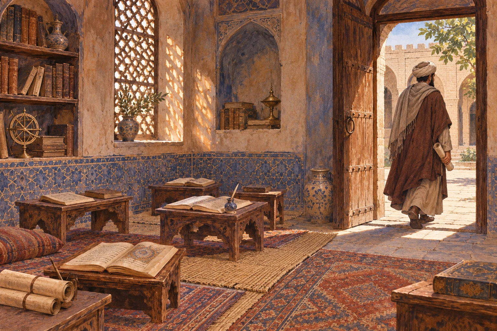
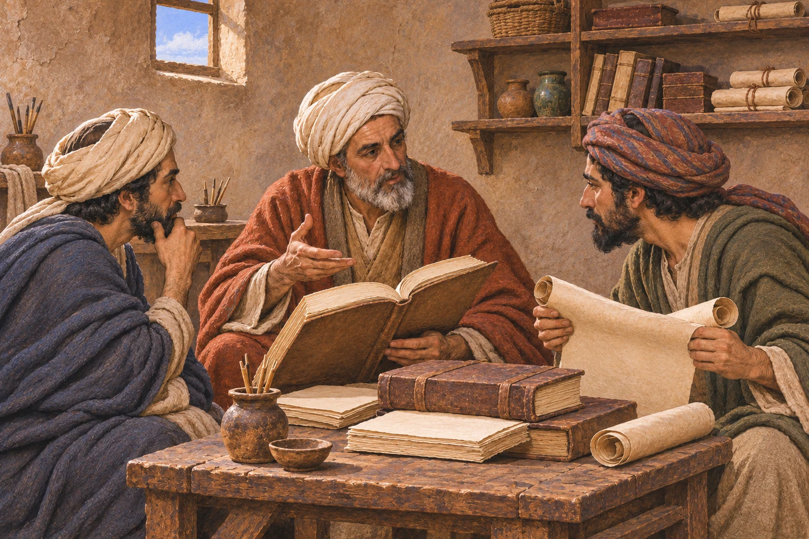
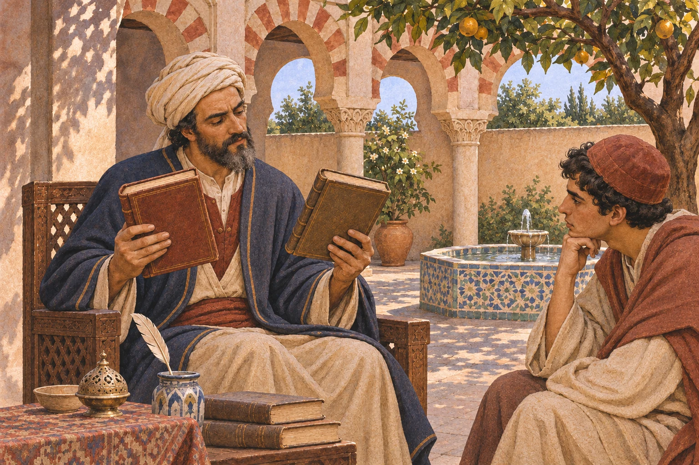
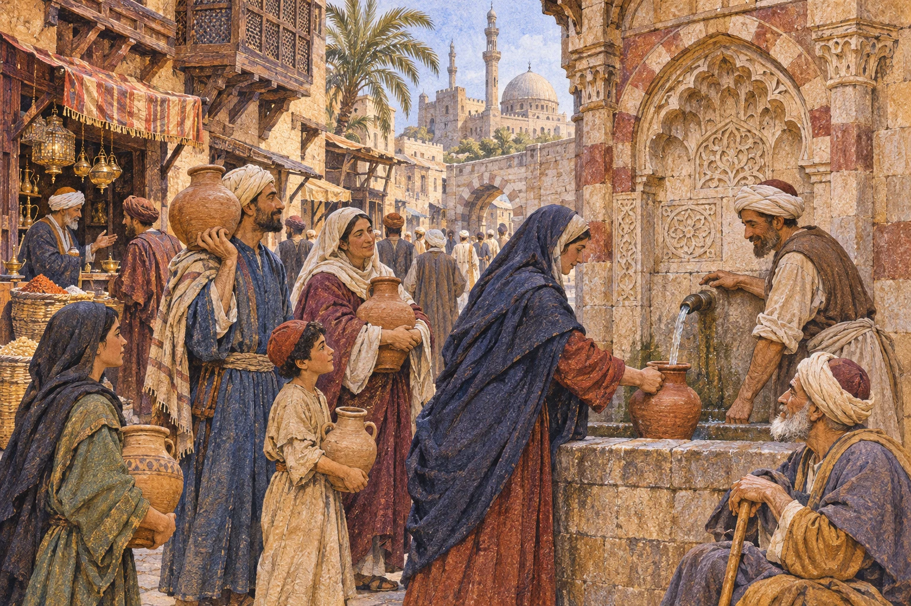

# The Teacher Who Could Not Speak

## The lecture that would not begin

In 1095, one of Baghdad’s most successful teachers cannot make himself speak. Al-Ghazali has a prestigious position, an audience, and a reputation for formidable learning. Yet, according to his later account, his tongue will not produce the lecture. Eating becomes difficult too. The man paid to explain the right way to live is no longer sure that his own life follows it. [[1]](https://www.ghazali.org/books/md/gz101.htm)

His problem is not that he has forgotten his material. He describes a struggle between religious commitment and attachment to status. Teaching can serve other people; it can also make the teacher famous. The same outward action can conceal different motives. Eventually, he leaves Baghdad, provides for his family, and begins years of travel and spiritual discipline. [[1]](https://www.ghazali.org/books/md/gz101.htm)

This is an account written afterward, with a religious purpose, not a doctor’s report. Still, its central difficulty is recognizable. A person can know the language of goodness extremely well and use it to build a comfortable career. The danger grows when everyone applauds. Al-Ghazali’s crisis takes us inside an Islamic argument about ethics: what joins correct reasoning, correct conduct, and a genuinely transformed character?

*An imagined departure evokes al-Ghazali’s account of leaving Baghdad. AI-generated illustration, not an authentic portrait or reconstruction.*

## How Baghdad acquired its arguments

To understand his classroom, we need to travel backward. The Abbasid dynasty took power in 750, and Baghdad was founded as its capital in 762. Wealth and political patronage helped make the city a major centre of learning. The empire’s political unity later weakened, but scholarship did not depend on a single capital forever. Courts and cities competed for talented people as well as territory. [[4]](https://www.metmuseum.org/ja/essays/the-art-of-the-abbasid-period-750-1258)

During the translation movement, scholars brought works of Greek philosophy and science into Arabic, sometimes through Syriac, a language used by Christian communities. Christians played important roles alongside Muslim scholars and patrons. Translators compared manuscripts, resolved difficult terms, and adapted knowledge to new audiences. This was skilled intellectual labour, not the mechanical transfer of words from one shelf to another. [[5]](https://www.journals.uchicago.edu/doi/full/10.1086/698236)

Books cost money. So did the time to study them. A patron could make an argument possible by supporting its author. That dependence also created pressure: the person paying for knowledge might expect loyalty. A scholar’s relationship to wealth was therefore more complicated than deciding whether money was good or bad. Someone had to pay for the lamp, but payment could bring a hand onto the page.

*Falsafa* names the philosophical tradition strongly shaped by Greek thinkers, especially Aristotle and Plato. *Kalam* is reasoned theology: argument about God, revelation, and belief. These were not neatly separated into “reason” and “no reason.” Their practitioners often disputed which kinds of reasoning were reliable, what counted as proof, and where human understanding reached its limits. Al-Ghazali moved across these intellectual worlds. [[2]](https://plato.stanford.edu/entries/al-ghazali/)

*Translation required interpretation, collaboration, and support. Imagined workshop; AI-generated illustration.*

Al-Farabi, who died in 950, asked what a good community is for. His virtuous city aims at genuine human fulfilment, not simply survival, pleasure, honour, or domination. Its members cooperate toward a good life under wise leadership. His account was hierarchical, not a proposal for modern democracy. But its challenge to a prosperous society remains sharp: being successful at acquiring things does not establish that the things acquired are worth making life about. [[3]](https://plato.stanford.edu/entries/al-farabi-soc-rel/)

A wealthy trading city could therefore fail by its own philosopher’s standards. Imagine a place that rewards clever deception and regards generosity as foolishness. Its warehouses might be full while its citizens become worse at living together. This invented example illustrates al-Farabi’s distinction between genuine fulfilment and goods mistakenly treated as ultimate ends. It does not establish that commerce itself is corrupt.

Ibn Sina, known in Latin as Avicenna, developed another enormously influential philosophical system. One distinction separates what a thing is—its essence—from the fact that it exists. Understanding the nature of a horse does not establish that a horse is standing outside. This seemingly abstract distinction became part of arguments about why anything exists and what depends on what. Ibn Sina was constructing new arguments, not merely preserving Aristotle. [[11]](https://plato.stanford.edu/entries/ibn-sina-metaphysics/)

## A critic who knew how to reason

Al-Ghazali studied the philosophers closely enough to explain their positions before attacking them. His *Incoherence of the Philosophers* challenged their claimed demonstrations on questions including the world’s eternity, God’s knowledge, and resurrection. He accepted the usefulness of logic while rejecting particular conclusions. The quarrel was partly about overconfidence: a method successful in one field did not automatically prove everything its users said about God. [[2]](https://plato.stanford.edu/entries/al-ghazali/)

The stakes went beyond winning a debate. He judged three philosophical positions incompatible with Islam itself. This was an argument about the boundaries of religious belonging as well as the strength of a proof. [[1]](https://www.ghazali.org/books/md/gz101.htm)

He also pursued Sufism, a diverse tradition of spiritual practice concerned with the purification of the self and closeness to God. Learning about sincerity was insufficient if a person remained driven by vanity. His own account compares knowledge about a condition with actually experiencing it. A description of drunkenness does not make someone drunk; a description of spiritual transformation does not accomplish the transformation. [[1]](https://www.ghazali.org/books/md/gz101.htm)

This concern extended to money. In his *Revival of the Religious Sciences*, al-Ghazali describes gold and silver as instruments that make exchange possible. He compares their usefulness to a mirror: they help relate and represent other things. Hoarding them frustrates their purpose. His objection is grounded in a view of what money is for, not simply a dislike of people having possessions. [[12]](https://www.ghazali.org/ihya/english/ihya-vol4-C2.htm)

That provides a useful meeting point with David Graeber, writing nine centuries later. Graeber’s account emphasizes that money and credit exist within human relationships and moral arrangements. Al-Ghazali reasons about their proper function within a divine order. They are not making the same argument, but both make it difficult to imagine money as an object whose ethical significance begins and ends with its owner’s wishes. [[13]](https://davidgraeber.org/articles/debt-violence-and-impersona-markets-polanyian-meditations/)

A lawful transaction might still accompany greed, humiliation, or indifference. Conversely, good intentions cannot make dishonest accounting harmless. Ethics has to examine both conduct and character. The broader ideal of *adab* joined cultivated learning with appropriate behaviour: education was also supposed to shape how people spoke, listened, and lived among others. A brilliantly argued insult could still reveal a poorly educated character. [[14]](https://www.iranicaonline.org/articles/adab-i-iran/)

## The reply from Córdoba

In the twelfth century, Ibn Rushd, known in Latin as Averroes, defended philosophy from within Islamic learning. He was a jurist as well as a philosopher. His *Decisive Treatise* asks about the religious status of philosophical inquiry and argues that qualified people should undertake it. Examining creation can deepen understanding of its creator. If a sound demonstration appears to conflict with scripture, interpretation may need greater care. [[6]](https://dev.oll.libertyfund.org/titles/rushd-the-philosophy-and-theology-of-averroes/read)

*Ibn Rushd argued for philosophical inquiry within Islamic learning. Imagined scene, not an authentic portrait; AI-generated illustration.*

This was not a claim that any interpretation is equally good. Ibn Rushd distinguished audiences and levels of understanding, and he worried about exposing unprepared readers to difficult arguments. His defence of reasoning came with boundaries. Even the people later celebrated as champions of reason did not necessarily share modern assumptions about equal access to every debate. [[7]](https://academic.oup.com/edited-volume/38657/chapter-abstract/335768582)

His reply to al-Ghazali was called *The Incoherence of the Incoherence*. Philosophers are not always immune to enjoying a title. More seriously, the exchange shows an ongoing argument inside Islamic intellectual life. Al-Ghazali did not switch philosophy off. Later scholars continued to study, modify, and dispute philosophical systems, often combining them with theology and spiritual thought. [[10]](https://plato.stanford.edu/entries/medieval-philosophy/)

The arguments also travelled. From the twelfth century, translators working in places including Toledo made Arabic philosophical works available in Latin. Ibn Sina became Avicenna; Ibn Rushd became Averroes. Thomas Aquinas engaged with their ideas, adopting some distinctions and rejecting other conclusions. Influence was an argument conducted across languages, not a parcel labelled “Greek wisdom” passed unopened to Europe. [[8]](https://plato.stanford.edu/entries/arabic-islamic-influence/)

A concrete example is the distinction between essence and existence: Aquinas developed it within his own Christian account of creation and God. Another is his opposition to an account associated with Averroes in which human beings share a single intellect. The disagreement mattered because thinking, personal identity, and individual responsibility were connected. A Christian philosopher’s rejection could itself show how deeply a Muslim philosopher had shaped the questions. [[15]](https://plato.stanford.edu/entries/aquinas/)

## What the fountain requires

War could destroy the institutions that sustained learning. Mongol forces sacked Baghdad in 1258 and killed its Abbasid caliph. Yet this catastrophe did not end Islamic intellectual life. Later Ilkhanid rulers converted to Islam and supported cultural production themselves. Conquest changed patrons and institutions; it did not impose one permanent outcome on every city and tradition. [[17]](https://www.metmuseum.org/pt/essays/the-art-of-the-ilkhanid-period-1256-1353)

Ethical ideas also took material form. A *waqf*, or endowed foundation, could dedicate property or income to an ongoing purpose. Cairo’s public drinking fountains were supported through such arrangements. The gift needed maintenance, water, and management after the donor’s moment of generosity had passed. A building could outlive its founder; the obligation to keep it useful had to outlive the founder too. [[16]](https://www.getty.edu/publications/heritagemanagement/part-two/9/)

*An endowment could turn a gift into an ongoing public service. Imagined late medieval setting; AI-generated illustration.*

A fountain brings the argument down to earth. The donor’s intention matters, but thirsty people need water, not access to the donor’s conscience. Reliable accounts matter, but perfect records cannot replace a broken supply. Sincerity, practical knowledge, money, and institutions meet in the same ordinary service.

In the fourteenth century, Ibn Khaldun extended this practical attention to rulers. In the *Muqaddimah*, he argued that attacks on people’s property and livelihoods weaken the work on which a prosperous society depends. When people expect their gains to be taken, their incentive to produce declines. Injustice can destroy the resources that power itself requires. [[9]](https://www.muslimphilosophy.com/ik/Muqaddimah/Chapter3/Ch_3_41.htm)

By then, al-Ghazali had been dead for centuries. His books had travelled much farther than his voice could have carried in the Baghdad classroom. People still disagreed about what he had proved. In cities where endowed fountains continued to operate, another kind of inheritance passed from hand to hand: water paid for by someone who was no longer there to receive thanks.

## Sources

1. [al-Ghazali, Deliverance from Error (Claud Field translation; public domain)](https://www.ghazali.org/books/md/gz101.htm)

2. [Stanford: al-Ghazali](https://plato.stanford.edu/entries/al-ghazali/)

3. [Stanford: al-Farabi’s Philosophy of Society and Religion](https://plato.stanford.edu/entries/al-farabi-soc-rel/)

4. [The Met: Abbasid Period](https://www.metmuseum.org/ja/essays/the-art-of-the-abbasid-period-750-1258)

5. [Translation movement research](https://www.journals.uchicago.edu/doi/full/10.1086/698236)

6. [Ibn Rushd: Decisive Treatise (public-domain translation)](https://dev.oll.libertyfund.org/titles/rushd-the-philosophy-and-theology-of-averroes/read)

7. [Oxford: Decisive Treatise scholarly overview](https://academic.oup.com/edited-volume/38657/chapter-abstract/335768582)

8. [Stanford: Influence on the Latin West](https://plato.stanford.edu/entries/arabic-islamic-influence/)

9. [Ibn Khaldun: Injustice and the Ruin of Civilization](https://www.muslimphilosophy.com/ik/Muqaddimah/Chapter3/Ch_3_41.htm)

10. [Stanford: Medieval philosophy and continued postclassical Arabic philosophy](https://plato.stanford.edu/entries/medieval-philosophy/)

11. [Stanford: Ibn Sina’s Metaphysics](https://plato.stanford.edu/entries/ibn-sina-metaphysics/)

12. [Al-Ghazali: Revival of the Religious Sciences, volume IV, patience and gratitude (Fazl-ul-Karim translation)](https://www.ghazali.org/ihya/english/ihya-vol4-C2.htm)

13. [David Graeber: Debt, Violence, and Impersonal Markets](https://davidgraeber.org/articles/debt-violence-and-impersona-markets-polanyian-meditations/)

14. [Encyclopaedia Iranica: Adab in Iran](https://www.iranicaonline.org/articles/adab-i-iran/)

15. [Stanford: Thomas Aquinas](https://plato.stanford.edu/entries/aquinas/)

16. [Getty: Heritage Values in Arabic-Islamic Traditions (waqf and fountains)](https://www.getty.edu/publications/heritagemanagement/part-two/9/)

17. [The Met: Art of the Ilkhanid Period](https://www.metmuseum.org/pt/essays/the-art-of-the-ilkhanid-period-1256-1353)
