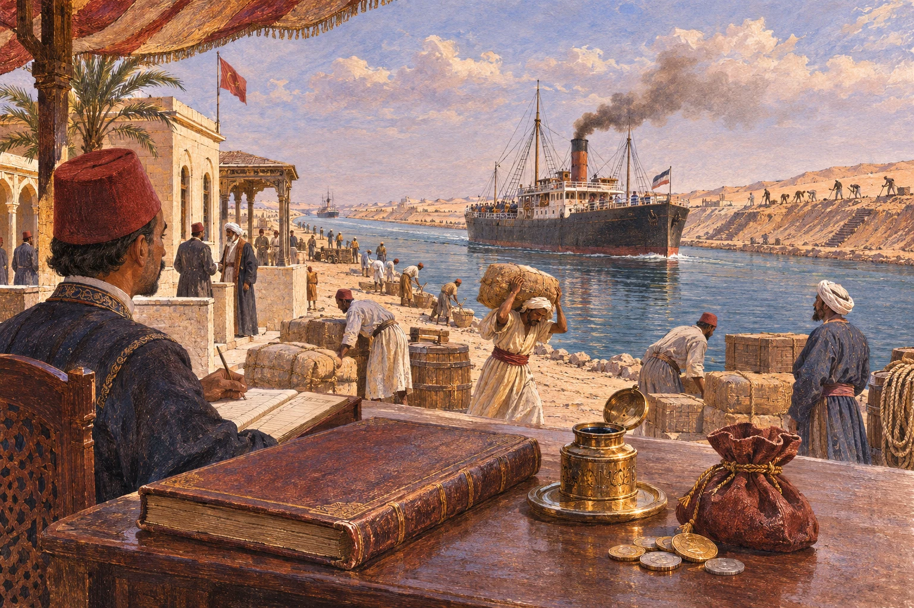
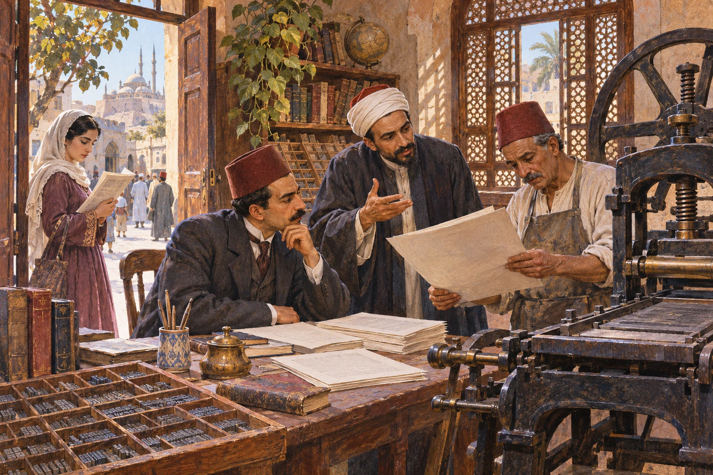
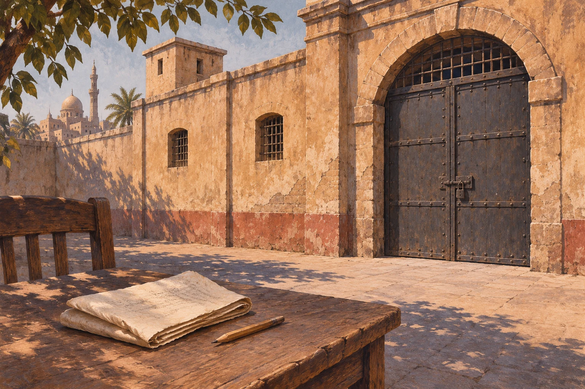
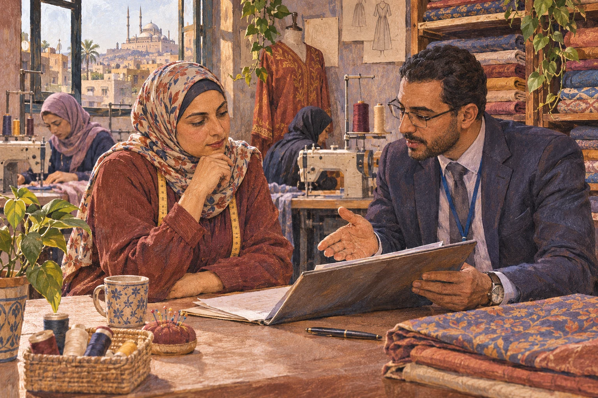

# When a Country Owes Money

## The bill arrives with a government attached

In 1875, Egypt’s ruler sells his government’s shares in the Suez Canal Company to Britain. The canal has made the route between Europe and Asia much shorter. It has also become part of a financial crisis. Khedive Ismail has borrowed heavily, and the bills cannot simply be postponed. A waterway dug through Egypt is increasingly becoming someone else’s source of influence. [[1]](https://www.imf.org/-/media/files/publications/wp/2019/wp1906.pdf)

Ismail’s ambitions included infrastructure, education, military ventures, and an expensive court. Foreign loans helped pay for them on terms that deepened the country’s difficulties. In 1876, an international debt commission gained control over revenues assigned to repayment. British and French financial supervision followed. Egypt’s creditors were no longer merely waiting for their money. They were acquiring powers over how the country collected and spent it. [[2]](https://tile.loc.gov/storage-services/master/frd/frdcstdy/eg/egyptcountrystud00metz/egyptcountrystud00metz.pdf)

For an Egyptian farmer, the important document might be a tax demand rather than a loan agreement. The farmer had not personally negotiated the ruler’s borrowing, yet public revenue would service the debt. This is the moral difficulty of sovereign debt: a state borrows, but the costs can reach people who had little say in the decision. An official signature travels surprisingly far.

*Infrastructure, labour, and debt became entangled with imperial power. Imagined nineteenth-century scene; AI-generated illustration.*

Resistance to foreign control and domestic privilege helped drive the movement led by the army officer Ahmed Urabi. In 1882, Britain bombarded Alexandria and invaded. British forces defeated Urabi’s army, and an occupation followed. Protecting strategic interests, particularly the canal route, mattered alongside financial interests and political conflict. Debt did not single-handedly cause conquest, but financial dependence had helped prepare the ground. [[1]](https://www.imf.org/-/media/files/publications/wp/2019/wp1906.pdf)

*Colonialism* involves outside powers establishing control over another society, often directing its resources and institutions toward imperial interests. Egypt’s experience did not look exactly like every other colony’s. Its formal political status and the actual location of power could differ. Local rulers remained involved even as British officials exercised decisive influence. Responsibility was distributed unequally, but it did not vanish behind the word “administration.” [[2]](https://tile.loc.gov/storage-services/master/frd/frdcstdy/eg/egyptcountrystud00metz/egyptcountrystud00metz.pdf)

## Repayment is not the whole account

David Graeber’s work on debt gives us a way to examine this episode. He challenges the habit of treating repayment as a sacred principle while leaving the circumstances of lending and enforcement outside the moral discussion. Applying his approach here means examining who borrowed, who benefited, who bore the costs, and whose power made collection possible. This is an application of Graeber’s argument, not a claim that he supplied this particular history of Egypt. [[11]](https://davidgraeber.org/articles/to-have-is-to-owe/)

The creditor’s claim cannot simply be dismissed: money may have financed useful works, and future cooperation depends partly on keeping agreements. But a valid claim to repayment does not automatically establish a right to govern the borrower’s country. These are different claims requiring different justifications. Nor does a ruler’s extravagance make every subject morally responsible for it.

For Muslim intellectuals, European domination created an additional pressure. European states possessed formidable technology and military power while often presenting their rule as a civilizing mission. Learning from their science did not require believing their conquests were just. Yet rejecting imperial power did not by itself explain how to reform education, government, or economic life. The practical question was what to change without surrendering the authority to decide.

## Two meanings of returning to the sources

Muhammad Abduh, an Egyptian scholar who lived from 1849 to 1905, argued for religious and educational reform. He treated reason as compatible with Islam, not as a foreign substance that would poison it. The inherited decisions of scholars needed examination rather than automatic repetition. Returning to foundational sources could therefore support change, not only resistance to change. [[3]](https://academic.oup.com/reference/62361/reference-article-abstract/554568546)

*Education and public debate were central to projects of reform. Imagined Cairo workshop around 1900; AI-generated illustration.*

*Ijtihad* means disciplined interpretive effort, particularly in deriving judgments from religious sources. It does not mean inventing any rule one happens to prefer. Abduh’s reforming approach sought resources within Islam for responding to modern conditions. A new school, a new financial arrangement, or a new public institution required reasoning about purposes as well as inherited precedents. Modernity did not arrive with an answer key. [[4]](https://academic.oup.com/reference/62361/reference-article-abstract/554574451)

A call to recover authentic religion could also support a much stricter programme. In eighteenth-century central Arabia, Muhammad ibn Abd al-Wahhab opposed practices he regarded as compromising worship of the one God, including appeals to saints. His alliance with Muhammad ibn Saud, conventionally dated to 1744, joined religious reform to expanding political power. This movement began before Britain occupied Egypt. Colonialism alone cannot explain every project of religious purification. [[7]](https://press.princeton.edu/books/ebook/9780691241609/wahhabism-0)

That difference helps clarify *fundamentalism*, a contested modern label. Here it describes movements claiming that recovery of authoritative religious foundations can remedy a corrupted present. It is not a synonym for being devout, praying regularly, or following established doctrine. “Orthodox” means accepted as correct within a particular tradition; it does not automatically mean revolutionary, violent, or hostile to learning. Different projects of return can lead in different directions. [[12]](https://www.cambridge.org/core/journals/religious-studies/article/on-defining-fundamentalism/5AAF2188C7E7414347D9C2CDA2B4335C)

The Ottoman Empire’s collapse after the First World War intensified arguments about political authority. In 1924, the new Turkish republic abolished the Ottoman caliphate, an institution claiming leadership of the Muslim community. It had never commanded the allegiance of every Muslim. Its abolition nevertheless made questions about religious authority, national government, and wider Muslim solidarity newly urgent. [[15]](https://www.cambridge.org/core/journals/social-science-history/article/caliphates-and-juntas-ottoman-legacies-in-todays-controversies-over-religion-and-state-in-the-arab-world/9925217FA0CAE58A31B0604B91E690CD)

In 1928, Hasan al-Banna founded the Muslim Brotherhood in Ismailia, in Egypt’s canal zone. He sought a society shaped comprehensively by Islamic principles. The movement combined religious education and social organization with growing political ambitions. Its surroundings made foreign power tangible: the canal, foreign businesses, and British military presence were part of everyday life. Reform was about dignity and authority as well as private belief. [[13]](https://imes.elliott.gwu.edu/app/uploads/2021/08/Islam-and-Politics-Curriculum-CCAS-GU.pdf)

## The schoolteacher and the prison

Sayyid Qutb began his career in education and literary criticism. His concern with economic injustice appeared in *Social Justice in Islam*, first published in 1949. He sought an Islamic account of social obligations beyond both unrestricted capitalism and communism. Wealth and domination were central to his political imagination, not minor additions to a theory about personal piety. His ideas changed substantially over his lifetime. [[6]](https://academic.oup.com/book/11603)

After the officers’ revolution of 1952, Gamal Abdel Nasser’s government and the Brotherhood came into conflict. Qutb was imprisoned during the crackdown beginning in 1954. Imprisonment, torture, and repression formed the setting in which his later radical thought developed. He was executed in 1966. These conditions help explain the urgency and hostility of his later writing; they do not make every conclusion in it justified. [[6]](https://academic.oup.com/book/11603)

*Repression formed part of the setting for Qutb’s later writing. Symbolic imagined scene; AI-generated illustration, not a historical prison record.*

Qutb argued that societies could call themselves Muslim while remaining in *jahiliyya*, a condition of ignorance or rejection of divine guidance. Human beings, he maintained, had usurped God’s authority to determine the governing order. His proposed remedy involved a committed group working to establish an authentically Islamic society. This was a radical challenge to existing Muslim governments, not simply a demand for stricter personal observance. [[5]](https://iep.utm.edu/qutb/)

The claim promises liberation from domination by other people. It also creates a severe problem: actual people must interpret and enforce what they describe as God’s rule. If their interpretation is treated as beyond challenge, religious certainty can protect a new form of domination. Identifying an injustice does not settle whether the proposed institution can be held accountable.

Qutb influenced later militant movements, including thinkers associated with al-Qaeda, but Muslim responses to his ideas were divided. Many rejected his judgments or his implications. *Islamism* broadly describes political projects seeking an order shaped by Islamic principles. It includes movements with different strategies. Violent jihadism is a narrower category; treating it as identical with Islamism, or with Islam itself, conceals precisely the disagreements this history contains. [[5]](https://iep.utm.edu/qutb/)

There was no single pendulum moving every Muslim society in step. In Iran, the 1979 revolution overthrew a monarchy supported by Western powers. Its opponents included religious activists, liberals, and leftists. Ayatollah Khomeini and his allies consolidated a new order centred on Shi‘a clerical authority. This was a different institutional and theological route from the Sunni movements discussed above, and its outcome was contested by people who had opposed the shah. [[8]](https://www.history.com/articles/1979-iranian-revolution-causes)

## The contract returns

Political movements did not monopolize Islamic responses to modern economic life. Modern Islamic finance also sought ways to connect commerce with religious requirements, including the prohibition of riba. It developed arrangements involving partnership, leasing, and sales rather than conventional interest-bearing loans. The aim of linking finance to real activity and allocating risk has deep historical roots, but modern banks operate in circumstances very different from a medieval port. [[9]](https://www.imf.org/external/pubs/ft/bop/2021/pdf/37/21-10.pdf)

*A contract’s effects unfold in the livelihood it helps—or burdens. Imagined contemporary scene; AI-generated illustration.*

Consider an invented example. A tailor needs a sewing machine. A financier buys it and sells it to the tailor for a disclosed higher price, payable later. This resembles a simplified *murabaha* transaction. A debt remains: the tailor owes the agreed sale price. Calling finance Islamic therefore does not mean every transaction eliminates debt or divides every future business loss equally. Different contracts assign different obligations. [[14]](https://ppp.worldbank.org/overview-assets-recycling-through-islamic-finance)

The ethical questions extend beyond the name of the contract. The total price may be transparent or confusing. The buyer may understand the commitment or sign under pressure. The arrangement may support a livelihood or absorb so much income that the livelihood becomes precarious. These possibilities do not prove that all financing methods are equivalent; they show why examining a legal form is only part of examining its effects.

The contrast with Egypt’s nineteenth-century crisis is a difference of scale, not an identity of circumstances. A household purchase and an imperial occupation have different histories and powers behind them. Yet both make visible the gap between a financial obligation and everything supposedly justified in collecting it. Graeber keeps that gap open for moral argument.

In the imagined workshop, the signature is dry. The financier has an enforceable claim; the tailor has a machine and orders to finish. The real consequences will emerge over months of work, payments, repairs, and interruptions. A document can record what is owed on the day it is signed. It cannot, by itself, tell the whole story of what the people involved will owe one another.

## Sources

1. [IMF: Public Debt Through the Ages (Egypt section)](https://www.imf.org/-/media/files/publications/wp/2019/wp1906.pdf)

2. [Library of Congress: Egypt, a Country Study](https://tile.loc.gov/storage-services/master/frd/frdcstdy/eg/egyptcountrystud00metz/egyptcountrystud00metz.pdf)

3. [Oxford Bibliographies: Muhammad Abduh](https://academic.oup.com/reference/62361/reference-article-abstract/554568546)

4. [Oxford Bibliographies: Ijtihad](https://academic.oup.com/reference/62361/reference-article-abstract/554574451)

5. [IEP: Sayyid Qutb](https://iep.utm.edu/qutb/)

6. [Oxford: Sayyid Qutb, Life and Legacy](https://academic.oup.com/book/11603)

7. [Cole Bunzel, Wahhabism: The History of a Militant Islamic Movement (Princeton University Press)](https://press.princeton.edu/books/ebook/9780691241609/wahhabism-0)

8. [History: 1979 Iranian Revolution](https://www.history.com/articles/1979-iranian-revolution-causes)

9. [IMF: Islamic Finance principles](https://www.imf.org/external/pubs/ft/bop/2021/pdf/37/21-10.pdf)

10. [Graeber: debt, slavery, freedom interview](https://davidgraeber.org/interviews/debt-slavery-and-our-idea-of-freedom/)

11. [David Graeber: To Have Is to Owe](https://davidgraeber.org/articles/to-have-is-to-owe/)

12. [Cambridge: On Defining Fundamentalism](https://www.cambridge.org/core/journals/religious-studies/article/on-defining-fundamentalism/5AAF2188C7E7414347D9C2CDA2B4335C)

13. [Georgetown / George Washington University: Islam and Politics curriculum](https://imes.elliott.gwu.edu/app/uploads/2021/08/Islam-and-Politics-Curriculum-CCAS-GU.pdf)

14. [World Bank: Islamic Finance Structures](https://ppp.worldbank.org/overview-assets-recycling-through-islamic-finance)

15. [Cambridge: Caliphates and Juntas — Ottoman Legacies](https://www.cambridge.org/core/journals/social-science-history/article/caliphates-and-juntas-ottoman-legacies-in-todays-controversies-over-religion-and-state-in-the-arab-world/9925217FA0CAE58A31B0604B91E690CD)
